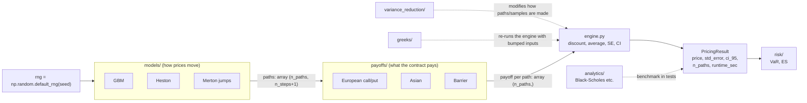

# Chapter 00 — Architecture: Models × Payoffs × Engine

## 1. What problem this solves

A bank's pricing library has to value thousands of different products (calls, puts,
Asians, barriers, baskets, ...) under several different views of how markets move
(constant volatility, stochastic volatility, jumps, ...). If every product were coded
separately for every model, you would need **M × N** pieces of code for M models and
N products — and a bug fix in one would have to be repeated in all the others.

Real libraries (and this project) avoid that by splitting the job into three
independent parts:

| Part | Question it answers | Example |
|------|---------------------|---------|
| **Model** | "How could the world evolve?" — produces simulated price paths | Geometric Brownian Motion, Heston |
| **Payoff** | "Given one path, how much does the contract pay?" | European call: max(S_T − K, 0) |
| **Engine** | "Average the payoffs, discount them, and report how sure we are" | returns a `PricingResult` |

Now you write **M + N** pieces of code, and *any payoff works with any model*. Adding a
new model instantly lets you price every existing product under it.

## 2. The math

### 2.1 The price we want

Option pricing theory (which we derive in Chapter 01) says the fair price today is

$$
V_0 = e^{-rT}\,\mathbb{E}^{\mathbb{Q}}\big[\,g(S)\,\big]
$$

- $V_0$ — the option's value today.
- $r$ — the risk-free interest rate (continuously compounded, per year).
- $T$ — time to maturity in years.
- $e^{-rT}$ — the **discount factor**: \$1 paid at time $T$ is worth $e^{-rT}$ today.
- $S = (S_{t_0}, S_{t_1}, \dots, S_{t_m})$ — a whole price path at times $0 = t_0 < \dots < t_m = T$.
- $g(S)$ — the **payoff**: the cash the contract pays on that path.
- $\mathbb{E}^{\mathbb{Q}}$ — an expectation (average) under the "risk-neutral"
  probability $\mathbb{Q}$. For now: it is the probability the **model** uses to simulate paths.

Notice how the formula already separates the pieces: the model defines the
distribution of $S$, the payoff defines $g$, and the engine computes $e^{-rT}\,\mathbb{E}[\cdot]$.

### 2.2 The Monte Carlo estimator

We can't compute the expectation exactly, so we simulate $n$ independent paths
$S^{(1)}, \dots, S^{(n)}$ and average:

$$
X_i = e^{-rT} g\big(S^{(i)}\big), \qquad
\hat V = \frac{1}{n}\sum_{i=1}^{n} X_i
$$

- $X_i$ — the discounted payoff on path $i$ (one "sample").
- $\hat V$ — our estimate of $V_0$ (the hat means "estimate").

By the **law of large numbers**, $\hat V \to V_0$ as $n \to \infty$ — the same idea you
used to estimate π and the dice probabilities.

### 2.3 How wrong could we be? Standard error and confidence interval

By the **central limit theorem**, for large $n$, $\hat V$ is approximately normal with
mean $V_0$ and standard deviation $\sigma/\sqrt{n}$, where $\sigma$ is the standard
deviation of one $X_i$. We don't know $\sigma$, so we estimate it from the samples:

$$
s = \sqrt{\frac{1}{n-1}\sum_{i=1}^{n}(X_i - \hat V)^2}, \qquad
\text{SE} = \frac{s}{\sqrt{n}}
$$

- $s$ — sample standard deviation (divide by $n-1$, not $n$, to remove bias).
- SE — **standard error**: the typical size of the error in $\hat V$.

A 95% confidence interval is

$$
\big[\hat V - 1.96\,\text{SE},\; \hat V + 1.96\,\text{SE}\big]
$$

because a standard normal variable lies in $[-1.96, 1.96]$ with probability 0.95.

**Intuition:** SE shrinks like $1/\sqrt{n}$. To halve the error you need **4×** the
paths; to get one more decimal digit you need **100×**. That slow rate is why later
chapters (variance reduction, QMC) exist — they shrink $s$ instead of growing $n$.

### 2.4 Our testing rule

Since $\hat V - V_0 \approx \text{SE}\cdot Z$ with $Z$ standard normal,
$|\hat V - V_0| < 3\,\text{SE}$ holds about 99.7% of the time. Every pricer is tested
against an exact formula with this rule. With a fixed seed the test is deterministic,
so it won't randomly flicker.

## 3. The design



If the diagram doesn't render (it needs a Mermaid-aware viewer such as GitHub), here
is the same idea in text:

```
  seed ─► Model ──paths (n_paths × n_steps+1)──► Payoff ──payoffs (n_paths)──► Engine ──► PricingResult
           GBM                                     call                          discount
           Heston                                  Asian                         mean, SE, CI
           Merton                                  barrier
```

### 3.1 The contract between the pieces

The pieces only talk through **NumPy arrays of fixed shape**. That's the whole trick:

- A **model** takes `(n_paths, n_steps, T, rng)` and returns `paths` with shape
  `(n_paths, n_steps + 1)`. Row `i` is one simulated path; column `j` is time $t_j$;
  column 0 is today's price $S_0$.
- A **payoff** takes `paths` and returns an array of shape `(n_paths,)` — one cash
  flow per path. It knows nothing about how the paths were made.
- The **engine** takes those payoffs, multiplies by $e^{-rT}$, and calls
  `PricingResult.from_samples`.

Because a payoff only sees an array, a call-option payoff written for GBM works
unchanged on Heston paths. (The exact function signatures get built in Chapter 03.)

### 3.2 Folder map

```
mc_engine/
  engine.py            PricingResult + (later) the generic pricing loop
  models/              path generators: GBM, Heston, Merton, correlated assets
  payoffs/             path -> cash flow functions
  variance_reduction/  antithetic, control variates, importance sampling, QMC
  greeks/              sensitivities (delta, gamma, vega, ...)
  analytics/           closed-form prices used as test benchmarks
  risk/                portfolio VaR and Expected Shortfall
tests/                 pytest: every pricer vs. a benchmark, within 3 SE
benchmarks/            speed comparisons (loops vs. NumPy vs. Numba)
docs/                  these chapters; plots in docs/figures/
reports/               generated output (tables, summaries)
```

### 3.3 Reproducibility: seeds

Every simulation receives a `numpy.random.Generator`, created once with
`np.random.default_rng(seed)`, and passes it down. We **never** call the global
`np.random.rand(...)`: global state makes results depend on what ran before, which
makes bugs impossible to reproduce.

## 4. Code walkthrough

`mc_engine/engine.py` — `PricingResult`:

- A **frozen dataclass**: a plain container with five fields (`price`, `std_error`,
  `ci_95`, `n_paths`, `runtime_sec`). "Frozen" means you can't accidentally overwrite
  a field after it's created.
- `PricingResult.from_samples(samples, runtime_sec)` does the arithmetic of §2.2–2.3
  once, so no pricer re-implements (and possibly gets wrong) the standard error. It
  uses `ddof=1` for the $n-1$ divisor and refuses fewer than 2 samples, where a
  standard deviation is undefined.
- `Z_95 = 1.959963984540054` is $\Phi^{-1}(0.975)$, the exact value behind "1.96".

`tests/test_engine.py` checks the arithmetic on a hand-computable example
(`[1,2,3,4,5]` → mean 3, SE $=\sqrt{0.5}$), applies the 3-SE rule to 100,000 normal
samples with a known mean, and checks the error for a single sample.

`.github/workflows/tests.yml` runs `pytest` on every push and pull request on GitHub.

## 5. Results

Nothing to price yet — this chapter sets up the skeleton. Run the tests with:

```
pytest -v
```

## 6. Common pitfalls

1. **Using `np.std` with the default `ddof=0`.** Slightly underestimates the error;
   matters for small `n`.
2. **Global random state** (`np.random.seed`, `np.random.rand`). Order-dependent results;
   use a passed-in `Generator`.
3. **Payoffs that peek at model details** (e.g. assume volatility is constant). This
   breaks "any payoff works with any model".
4. **Mixing up the axes**: paths are `(n_paths, n_steps+1)`. `paths[:, -1]` is the final
   price on every path; `paths[-1]` is the *last path* — a silent bug.
5. **Forgetting to discount.** You get $\mathbb{E}[g]$ instead of $e^{-rT}\mathbb{E}[g]$;
   tests against Black-Scholes will catch it.

## 7. Interview questions

1. **Why separate models from payoffs?**
   It turns M × N implementations into M + N, lets every payoff run under every model,
   and means each piece can be tested in isolation.
2. **What is the standard error of a Monte Carlo estimate and how does it scale?**
   $\text{SE} = s/\sqrt{n}$. It falls as $1/\sqrt{n}$: 4× the paths halves the error.
3. **How do you test a Monte Carlo pricer whose output is random?**
   Fix the seed and compare against an analytical price, accepting if the difference
   is under ~3 SE. Also check the SE itself falls like $1/\sqrt{n}$.
4. **Why does Monte Carlo beat grid methods (PDEs, trees) in high dimensions?**
   Its error rate $1/\sqrt{n}$ doesn't depend on the number of dimensions, while grid
   methods need exponentially more points as dimensions grow.
5. **What does a 95% confidence interval mean here?**
   If we reran the whole simulation with many different seeds, about 95% of the
   intervals built this way would contain the true price.

## 8. Exercises

1. Rewrite your π estimator (`calc_pi2.py`) so it returns a `PricingResult`
   (hint: each sample is `4 * (x² + y² ≤ 1)`). Check that π lies inside `ci_95`.
2. Using `PricingResult.from_samples`, plot SE against `n` on log-log axes for
   `n = 100, 1000, ..., 10⁶`. What slope do you get? Why?
3. Run the π estimate with 200 different seeds and count how often the true π lies
   inside `ci_95`. Is it close to 95%?
