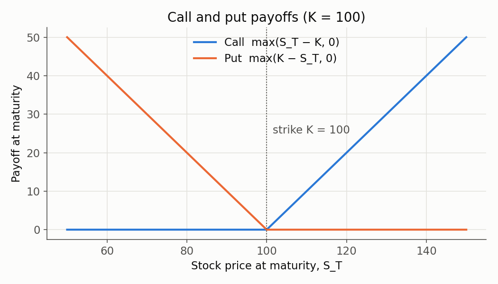
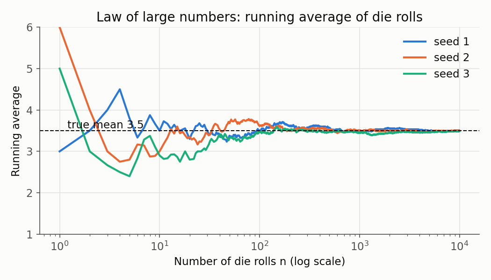
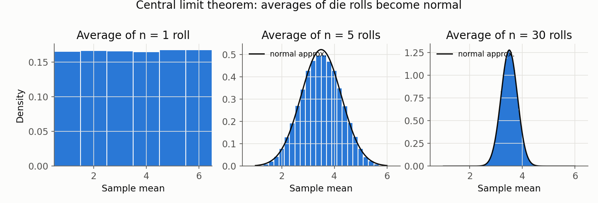
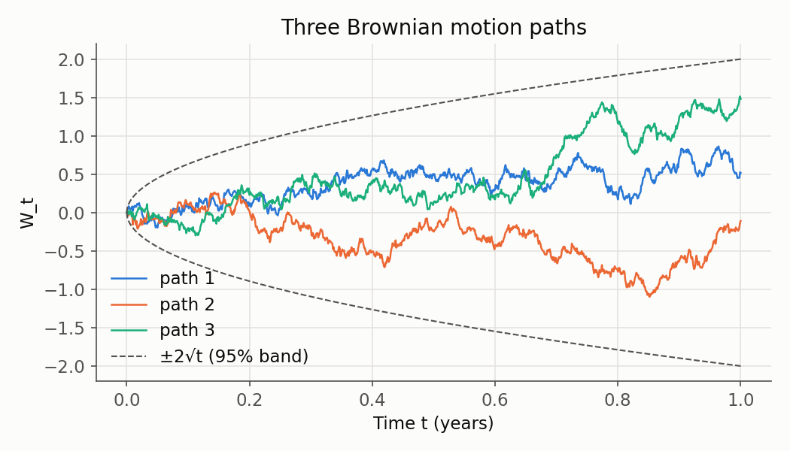

# Chapter 01: Foundations

This chapter covers everything you need before writing a pricer: what options are,
the probability that describes them, the two theorems that make Monte Carlo work, the
random process that drives stock prices, and the central idea of the course:

> **The price of an option is its discounted expected payoff, where "expected" is
> computed under the risk-neutral probability.**

There's no code in this chapter. Every idea gets a small example you can check with a
calculator.

**Contents**

1. [What problem this solves](#1-what-problem-this-solves)
2. [Finance building blocks](#2-finance-building-blocks): stocks, options, payoffs, interest, discounting
3. [Probability toolkit](#3-probability-toolkit): random variables, expectation, variance, the normal distribution
4. [Why Monte Carlo works](#4-why-monte-carlo-works-lln-and-clt): law of large numbers, central limit theorem
5. [Brownian motion](#5-brownian-motion)
6. [Risk-neutral pricing](#6-risk-neutral-pricing)
7. [Code walkthrough](#7-code-walkthrough)
8. [Results summary](#8-results-summary)
9. [Common pitfalls](#9-common-pitfalls)
10. [Interview questions](#10-interview-questions)
11. [Exercises](#11-exercises)

---

## 1. What problem this solves

Banks, hedge funds, insurers and pension funds hold contracts whose future cash flows
depend on prices nobody can predict. They still need to know, **today**, what those
contracts are worth. They need that number to trade them, to report profit and loss,
to set capital aside against losses, and to hedge.

This chapter builds the logic that turns "an uncertain future cash flow" into "one
number today". Monte Carlo is the computer's way of carrying that logic out for
contracts too complicated for a formula. Every chapter after this one is a
refinement of the ideas here.

---

## 2. Finance building blocks

### 2.1 Stocks

A **stock** (or share) is a small piece of ownership in a company. It trades on an
exchange, and its price changes every second as people buy and sell.

- $S_t$: the stock price at time $t$, with time measured **in years** from today.
- $S_0$: the price today, which we know.
- $S_T$: the price at a future date $T$. **Today it's a random quantity.**

Example: a share trades at $S_0 = 100$. In one year, $S_1$ could be 80, 100, 130 or
anything else. All of the uncertainty in this course comes from not knowing $S_T$.

### 2.2 Options

An **option** is a contract between two parties. The buyer (the "long" side) pays an
upfront price, called the **premium**, and gets a **right but not an obligation**:

- A **call option** gives the right to **buy** the stock at a fixed price $K$ on date $T$.
- A **put option** gives the right to **sell** the stock at a fixed price $K$ on date $T$.

Symbols:

- $K$: the **strike price**, the price fixed in the contract.
- $T$: the **maturity** (or expiry), when the right can be used ("exercised").

We start with **European** options, which can only be exercised on date $T$.
**American** options can be exercised any time up to $T$; they come in Chapter 12.

The seller (the "short" side) receives the premium and must deliver whatever the
buyer is owed.

**Why do these exist?** A call lets you profit if the stock rises, while risking only
the premium. A put works like insurance: an investor who owns the stock and buys a put
with $K = 90$ can't lose more than 10 per share, however far the stock falls.

### 2.3 Payoffs

The **payoff** is the cash the option pays at maturity. A rational holder exercises
only when it helps:

- Call: if $S_T > K$, buy at $K$ and immediately sell at $S_T$, earning $S_T - K$.
  Otherwise walk away with 0.
- Put: if $S_T < K$, buy at $S_T$ and sell at $K$, earning $K - S_T$. Otherwise 0.

$$
\text{call payoff} = \max(S_T - K,\ 0) \qquad\qquad \text{put payoff} = \max(K - S_T,\ 0)
$$

The shorthand $(x)^+ = \max(x, 0)$ is common, so the call payoff is also written $(S_T - K)^+$.

**Example** with $K = 100$:

| $S_T$ | Call payoff | Put payoff | Call − Put |
|------:|------------:|-----------:|-----------:|
|  80   | 0           | 20         | −20        |
|  90   | 0           | 10         | −10        |
| 100   | 0           | 0          | 0          |
| 110   | 10          | 0          | 10         |
| 120   | 20          | 0          | 20         |



Two things to notice:

1. **Payoffs are never negative.** Owning an option can't cost you anything at
   maturity, so it must cost something today. That cost is the premium we're
   trying to find.
2. **The last column is always $S_T - K$.** A long call plus a short put pays exactly
   what owning the stock minus $K$ pays. This leads to **put–call parity** (§6.4), a
   free check on every pricer we build.

**Payoff vs. profit.** Profit = payoff − premium paid. If the call costs 10 and
$S_T = 115$, the payoff is 15 and the profit is 5. This course is about finding the
premium, so we work with payoffs.

### 2.4 Interest rates and discounting

Money today is worth more than the same amount later, because money today can earn
interest. The **risk-free rate** $r$ is the interest rate on a loan that's certain to
be repaid (in practice, roughly the rate on short-term government debt). Rates are
quoted per year as decimals: 5% means $r = 0.05$.

**Compounding.** Invest \$100 at 5% for one year:

| How often interest is paid | Formula | Value after 1 year |
|---|---|---:|
| Once a year | $100\,(1 + 0.05)$ | 105.000 |
| Monthly | $100\,(1 + 0.05/12)^{12}$ | 105.116 |
| Continuously | $100\,e^{0.05}$ | 105.127 |

Where does $e$ come from? Paying interest $m$ times a year at rate $r/m$ for $T$
years gives $(1 + r/m)^{mT}$. A standard calculus limit says
$\lim_{m\to\infty}(1 + r/m)^{m} = e^{r}$, so with interest paid continuously:

$$
\text{value at } T = \text{value today} \times e^{rT}
$$

We always use **continuous compounding**. It makes the math clean: growing for $T_1$
years and then $T_2$ years is $e^{rT_1}e^{rT_2} = e^{r(T_1 + T_2)}$.

**Discounting** runs the same calculation backwards. A certain payment $X$ at time
$T$ is worth, today,

$$
\text{present value} = e^{-rT}\,X
$$

- $e^{-rT}$ is the **discount factor**. It lies between 0 and 1 whenever $r > 0$.

**Example:** you'll receive \$110 in 2 years, and $r = 5\%$. Its value today is
$110\,e^{-0.05 \times 2} = 110 \times 0.904837 = 99.53$. You'd be indifferent
between \$99.53 now and \$110 in two years, because investing \$99.53 at 5% grows
into exactly \$110.

**Why discounting matters for options:** an option pays at time $T$, not today, so
its payoff has to be brought back to today with $e^{-rT}$.

---

## 3. Probability toolkit

### 3.1 Random variables

A **random variable** is a number whose value depends on chance. We write it with a
capital letter, such as $X$.

- **Discrete:** takes a list of values, each with a probability. A fair die
  $X \in \{1,\dots,6\}$ has $P(X = k) = 1/6$.
- **Continuous:** can take any value in a range. Probabilities come from a
  **probability density function** (pdf) $f(x)$:
  $P(a \le X \le b) = \int_a^b f(x)\,dx$, and $\int_{-\infty}^{\infty} f(x)\,dx = 1$.

$S_T$ is a continuous random variable, and so is an option's payoff.

### 3.2 Expectation (the mean)

The **expectation** $\mathbb{E}[X]$ is the probability-weighted average value, the
"centre of mass" of the distribution:

$$
\mathbb{E}[X] = \sum_k x_k\,P(X = x_k) \quad\text{(discrete)} \qquad
\mathbb{E}[X] = \int_{-\infty}^{\infty} x\,f(x)\,dx \quad\text{(continuous)}
$$

**Die:** $\mathbb{E}[X] = (1+2+3+4+5+6)/6 = 3.5$. No single roll gives 3.5. It's the
long-run average.

**Expectation of a function.** For any function $g$,
$\mathbb{E}[g(X)] = \sum_k g(x_k)\,P(X = x_k)$. This is how we take the expectation of a payoff.

**Linearity:** $\mathbb{E}[aX + bY] = a\,\mathbb{E}[X] + b\,\mathbb{E}[Y]$ for
constants $a, b$, always, even if $X$ and $Y$ are dependent.

**Example: expected call payoff in a toy world.** Suppose

| $S_T$ | 80 | 100 | 120 |
|---|---|---|---|
| probability | 0.25 | 0.50 | 0.25 |

Then $\mathbb{E}[S_T] = 0.25(80) + 0.5(100) + 0.25(120) = 100$. For a call with
$K = 100$, the payoffs are $0, 0, 20$, so

$$
\mathbb{E}[\max(S_T - 100, 0)] = 0.25(0) + 0.5(0) + 0.25(20) = 5.
$$

Compare this with plugging the average price into the payoff:
$\max(\mathbb{E}[S_T] - 100, 0) = \max(0, 0) = 0$. **The two answers differ.** The
expectation of a non-linear function is not the function of the expectation. (The
general result is called **Jensen's inequality**.)

This is why options are worth more when prices are more volatile. Spread the toy
distribution to $\{60, 100, 140\}$ and the average stays 100, but the expected call
payoff doubles to $0.25 \times 40 = 10$. The option gains from big up-moves and loses
nothing extra on big down-moves.

### 3.3 Variance and standard deviation

**Variance** measures how spread out $X$ is around its mean $\mu = \mathbb{E}[X]$:

$$
\operatorname{Var}(X) = \mathbb{E}\big[(X - \mu)^2\big] = \mathbb{E}[X^2] - \mu^2
$$

The **standard deviation** $\sigma = \sqrt{\operatorname{Var}(X)}$ is in the same
units as $X$, so it's the number to quote.

**Die:** $\mathbb{E}[X^2] = (1 + 4 + 9 + 16 + 25 + 36)/6 = 91/6 \approx 15.167$, so
$\operatorname{Var}(X) = 15.167 - 3.5^2 = 2.917$ and $\sigma = 1.708$.

**Toy call payoff** from §3.2: $\mathbb{E}[\text{payoff}^2] = 0.25 \times 20^2 = 100$,
so $\operatorname{Var} = 100 - 5^2 = 75$ and $\sigma \approx 8.66$. The payoff is very
noisy compared with its mean of 5. Monte Carlo has to cope with that noise.

**Three rules we use constantly:**

1. $\operatorname{Var}(aX + b) = a^2\operatorname{Var}(X)$. Shifting by $b$ doesn't
   change the spread, and scaling by $a$ scales the spread by $|a|$.
2. If $X$ and $Y$ are **independent**, $\operatorname{Var}(X + Y) = \operatorname{Var}(X) + \operatorname{Var}(Y)$.
3. Putting 1 and 2 together gives **the most important formula in Monte Carlo.** Let
   $X_1, \dots, X_n$ be independent copies of $X$, each with variance $\sigma^2$, and
   let $\bar X_n = \frac{1}{n}\sum_{i=1}^n X_i$ be their average. Then

$$
\operatorname{Var}(\bar X_n) = \frac{1}{n^2}\sum_{i=1}^n \operatorname{Var}(X_i)
= \frac{1}{n^2}\cdot n\sigma^2 = \frac{\sigma^2}{n},
\qquad
\operatorname{sd}(\bar X_n) = \frac{\sigma}{\sqrt n}.
$$

So averaging $n$ independent samples cuts the spread by a factor $\sqrt n$.

### 3.4 The normal distribution

A random variable $X$ is **normal** with mean $\mu$ and variance $\sigma^2$, written
$X \sim N(\mu, \sigma^2)$, if its pdf is the bell curve

$$
f(x) = \frac{1}{\sigma\sqrt{2\pi}}\exp\!\left(-\frac{(x - \mu)^2}{2\sigma^2}\right).
$$

The **standard normal** is $Z \sim N(0, 1)$. Its cumulative distribution function is
$\Phi(z) = P(Z \le z)$, which has no closed form; we look it up or let the computer
compute it.

**Standardising:** if $X \sim N(\mu, \sigma^2)$ then $Z = (X - \mu)/\sigma \sim N(0, 1)$.
Going the other way, $X = \mu + \sigma Z$. **That's how we'll generate any normal
variable: draw $Z$, then scale and shift.**

**Rules of thumb:** $P(|Z| \le 1) \approx 68\%$, $P(|Z| \le 1.96) = 95\%$,
$P(|Z| \le 3) \approx 99.7\%$.

**Example:** a stock's one-year return is modelled as $N(8\%, (20\%)^2)$. What's the
chance of losing more than 12%? $(-0.12 - 0.08)/0.20 = -1$, so $P(Z < -1) = \Phi(-1) \approx 15.9\%$.

**Two facts we'll need:**

1. **Sums of independent normals are normal:** if $X \sim N(\mu_1, \sigma_1^2)$ and
   $Y \sim N(\mu_2, \sigma_2^2)$ are independent, then $X + Y \sim N(\mu_1 + \mu_2,\ \sigma_1^2 + \sigma_2^2)$.
2. **Lognormal mean:** if $X \sim N(\mu, \sigma^2)$, then $e^X$ is called
   **lognormal**, and
   $$\mathbb{E}\big[e^X\big] = e^{\mu + \sigma^2/2}.$$
   (Proof sketch: write $\int e^x f(x)\,dx$ and complete the square in the exponent.)
   Example: $X \sim N(0, 0.2^2)$ gives $\mathbb{E}[e^X] = e^{0.02} = 1.0202$, not
   $e^0 = 1$. Jensen again: randomness pushes the average of a convex function up.
   We use this in §5.5 to explain a mysterious $-\sigma^2/2$.

---

## 4. Why Monte Carlo works: LLN and CLT

The plan for the whole course:

1. Write the option price as an expectation, $\mathbb{E}[\text{something}]$ (§6).
2. Draw many independent random samples of that something on a computer.
3. Average them.

Two theorems tell us the average is right (LLN) and how wrong it might be (CLT).

### 4.1 The law of large numbers (LLN)

Let $X_1, X_2, \dots$ be independent samples of $X$ with $\mathbb{E}[X] = \mu$. Then the
sample mean converges to the true mean:

$$
\bar X_n = \frac{1}{n}\sum_{i=1}^{n} X_i \;\longrightarrow\; \mu \quad \text{as } n \to \infty.
$$

(Strictly, this holds "with probability 1".) You've already used this. Your π script
estimates $P(\text{dart lands in circle}) = \pi/4$ by the fraction of darts that do,
and your dice script estimates probabilities by frequencies.



*Running average of die rolls for three seeds. Early on they wander far from 3.5;
by $n = 10{,}000$ all three sit almost exactly on it.*

The LLN guarantees we get there. It doesn't say **how fast**. That's the CLT's job.

### 4.2 The central limit theorem (CLT)

If the $X_i$ are independent with mean $\mu$ and **finite** variance $\sigma^2$,
then for large $n$

$$
\bar X_n \;\approx\; N\!\left(\mu,\ \frac{\sigma^2}{n}\right),
\qquad\text{equivalently}\qquad
\frac{\bar X_n - \mu}{\sigma/\sqrt n} \;\approx\; N(0, 1).
$$

The striking part: **this is true whatever the shape of the distribution of $X$**.
A single die roll is flat (uniform), but averages of rolls quickly become a bell curve:



*100,000 averages of $n$ die rolls (seed 7). Black curve: the normal distribution the
CLT predicts, $N(3.5,\ 2.917/n)$. By $n = 30$ the match is nearly perfect.*

### 4.3 Standard error and confidence intervals

The standard deviation of the average, $\sigma/\sqrt n$, is called the **standard
error (SE)**. We don't know the true $\sigma$, so we estimate it from the samples with
the **sample standard deviation**

$$
s = \sqrt{\frac{1}{n-1}\sum_{i=1}^n (X_i - \bar X_n)^2},
\qquad
\text{SE} = \frac{s}{\sqrt n}.
$$

(We divide by $n - 1$ rather than $n$ because $\bar X_n$ was itself fitted to the
same data, which makes the squared deviations slightly too small. Dividing by $n-1$
corrects for that.)

Because $\bar X_n$ is approximately normal, the true mean lies in

$$
\big[\bar X_n - 1.96\,\text{SE},\ \ \bar X_n + 1.96\,\text{SE}\big]
$$

about 95% of the time. That's the **95% confidence interval**.

**Die example.** One die roll has $\sigma = 1.708$. Averaging $n$ rolls gives:

| $n$ | SE $= 1.708/\sqrt n$ | 95% CI half-width $= 1.96 \times$ SE |
|---:|---:|---:|
| 100 | 0.171 | 0.335 |
| 10,000 | 0.0171 | 0.0335 |
| 1,000,000 | 0.00171 | 0.00335 |

**Each extra correct decimal place costs 100× more samples.** This $1/\sqrt n$ rate
is Monte Carlo's main weakness. Chapters 05–06 attack it by making $\sigma$ smaller
rather than $n$ bigger. It's also Monte Carlo's main strength: the rate doesn't depend
on how many random inputs the problem has, which is why it beats grid methods for
complicated products.

---

## 5. Brownian motion

We need a model for how $S_t$ moves randomly through time. The basic building block
is **Brownian motion**, the continuous-time version of a coin-flip random walk.

### 5.1 From a random walk to Brownian motion

Chop $[0, t]$ into small steps of length $\Delta t$. At each step, flip a fair coin
and move up or down by $\delta$. After $N = t/\Delta t$ steps, the position is a sum of
$N$ independent $\pm\delta$ moves, each with mean 0 and variance $\delta^2$. So

$$
\text{mean} = 0, \qquad \text{variance} = N\delta^2 = \frac{t}{\Delta t}\,\delta^2.
$$

Now shrink $\Delta t \to 0$. How should the step size $\delta$ shrink with it?

- If $\delta = \Delta t$: variance $= t\,\Delta t \to 0$. The walk freezes and nothing random is left.
- If $\delta$ is constant: variance $\to \infty$. The walk explodes.
- If $\delta = \sqrt{\Delta t}$: variance $= t$ **for every $\Delta t$**. This is the only
  choice that gives a sensible limit.

So **steps scale like $\sqrt{\Delta t}$**. Remember this, because it's behind the
"volatility scales with $\sqrt{\text{time}}$" rule. And since the position is a sum of
many small independent steps, the CLT says it's normal in the limit: $N(0, t)$.

Example: with $\Delta t = 0.01$ (100 steps per year), each step is $\pm 0.1$.
After one year the variance is $100 \times 0.01 = 1$.

### 5.2 Definition

A **standard Brownian motion** (also called a **Wiener process**) $W_t$ is a random
function of time with:

1. $W_0 = 0$.
2. **Independent increments:** the moves over non-overlapping time intervals are independent.
3. **Normal increments:** for $s < t$, $W_t - W_s \sim N(0,\ t - s)$.
4. **Continuous paths:** no jumps.

Consequences: $\mathbb{E}[W_t] = 0$, $\operatorname{Var}(W_t) = t$, and the typical
size of $W_t$ is $\sqrt t$. (Also, $\operatorname{Cov}(W_s, W_t) = \min(s, t)$.)



*Three Brownian paths (1,000 steps, seed 11). Each path is very rough, yet the cloud of
possible paths spreads out like $\pm\sqrt t$, not like $t$. About 95% of paths end
inside the dashed band.*

### 5.3 Simulating a path by hand

Property 3 gives the recipe directly. Draw independent $Z_1, Z_2, \dots \sim N(0, 1)$ and set

$$
W_{t + \Delta t} = W_t + \sqrt{\Delta t}\,Z.
$$

**Example:** quarterly steps ($\Delta t = 0.25$, so $\sqrt{\Delta t} = 0.5$), with
draws $Z = 0.5,\ -1.2,\ 0.3,\ 0.8$:

| $t$ | $Z$ | increment $0.5Z$ | $W_t$ |
|---:|---:|---:|---:|
| 0.00 | | | 0.00 |
| 0.25 | 0.5 | 0.25 | 0.25 |
| 0.50 | −1.2 | −0.60 | −0.35 |
| 0.75 | 0.3 | 0.15 | −0.20 |
| 1.00 | 0.8 | 0.40 | 0.20 |

That's exactly what the computer will do, with millions of paths at once.

### 5.4 The $\sqrt{t}$ rule in practice

- $P(W_1 > 2) = P(Z > 2) \approx 2.3\%$, but $P(W_4 > 2) = P(2Z > 2) = P(Z > 1) \approx 15.9\%$.
  Four times the horizon only doubles the typical move.
- If a stock's annual volatility is 20%, its daily volatility (252 trading days a year)
  is $20\%/\sqrt{252} \approx 1.26\%$, not $20\%/252$.

### 5.5 Preview: a stock price built from Brownian motion

Brownian motion can go negative and stock prices can't, so we model **percentage
changes** as random. That means putting $W_t$ inside an exponential:

$$
S_t = S_0 \exp\!\Big(\big(\mu - \tfrac12\sigma^2\big)t + \sigma W_t\Big)
$$

- $\mu$: the **drift**, the stock's expected growth rate per year.
- $\sigma$: the **volatility**, how strongly the price fluctuates (0.20 = "20% vol").
- This model is **geometric Brownian motion (GBM)**. $S_t$ is lognormal and always positive.

**Why the $-\frac12\sigma^2$?** So that the stock grows at rate $\mu$ on average.
Since $\sigma W_t \sim N(0, \sigma^2 t)$, the lognormal mean from §3.4 gives
$\mathbb{E}[e^{\sigma W_t}] = e^{\sigma^2 t/2}$. Then

$$
\mathbb{E}[S_t] = S_0\, e^{(\mu - \sigma^2/2)t}\; e^{\sigma^2 t / 2} = S_0\, e^{\mu t}. \checkmark
$$

Without the correction, randomness alone would push the average up. Chapter 02
derives GBM properly (from Itô's lemma) and Chapter 03 simulates it.

---

## 6. Risk-neutral pricing

### 6.1 The obvious guess, and why it's wrong

Section 2 suggests a guess: price = $e^{-rT}\,\mathbb{E}[\text{payoff}]$, using the
**real-world** probabilities. That guess has two problems:

1. **Nobody agrees on the real-world probabilities.** An optimist and a pessimist
   would quote different prices, yet the market has one price.
2. **People dislike risk.** A risky payoff with expected value 10 is worth *less* than
   a certain 10. How much less depends on everyone's appetite for risk, which can't
   be measured.

The fix comes from an idea that needs neither: **no arbitrage**.

### 6.2 No arbitrage and replication

An **arbitrage** is a free lunch: a strategy that costs nothing (or makes money
today), can never lose, and sometimes wins. In a working market, traders spot these
and trade them away immediately. So we assume **none exist**.

The key consequence (the "law of one price"): **if two portfolios pay exactly the
same amount in every possible future, they must cost the same today.** If they
didn't, you'd buy the cheap one, sell the expensive one, and pocket the difference
risk-free.

So if we can build the option's payoff out of things whose prices we already know
(stock and cash), that recipe's cost *is* the option's price. Building the payoff
this way is called **replication**.

### 6.3 The one-period binomial model

This is the simplest world where the idea works. Today $S_0 = 100$. In one year
($T = 1$) the stock is either

```
                 ┌── up:   S_u = 120     call pays C_u = max(120 − 100, 0) = 20
   S_0 = 100 ────┤
                 └── down: S_d =  90     call pays C_d = max( 90 − 100, 0) =  0
```

The risk-free rate is $r = 5\%$, so cash grows by $e^{0.05} = 1.051271$. Price a
call with $K = 100$.

**Replicate it.** Buy $\Delta$ shares and put $B$ in the bank (negative $B$ means
borrowing). At $T = 1$ this portfolio is worth $\Delta S_T + B e^{r}$. Make it match
the call in both states:

$$
\begin{aligned}
\text{up:}\quad & 120\Delta + B e^{0.05} = 20 \\
\text{down:}\quad & \;\;90\Delta + B e^{0.05} = 0
\end{aligned}
$$

Subtract the second equation from the first: $30\Delta = 20$, so $\Delta = 2/3$.
Then $B e^{0.05} = -60$, so $B = -60e^{-0.05} = -57.0738$ (borrow 57.07).

**Cost today** = $\Delta S_0 + B = \tfrac23(100) - 57.0738 = \mathbf{9.5929}$.

That **must** be the call price. Here's why. Suppose the call traded at 12:

| Action today | Cash today |
|---|---:|
| Sell the call | +12.00 |
| Buy 2/3 share | −66.67 |
| Borrow | +57.07 |
| **Net** | **+2.41** |

At $T = 1$: in the up state the shares are worth 80; repay the loan (60) and pay the
call holder (20), leaving 0. In the down state the shares are worth 60; repay the loan
(60) and the call pays nothing, leaving 0. **You keep \$2.41 with zero risk**, which
is an arbitrage. If the call traded below 9.59, you'd do the reverse.

**Notice what's missing:** we never used the probability of going up. It could be
10% or 90%; the replication works in both states regardless. So the real-world
probabilities and everyone's attitude to risk drop out entirely.

### 6.4 Where "risk-neutral" comes from

Rewrite the answer in a form that looks like an expectation. Define

$$
q = \frac{S_0 e^{rT} - S_d}{S_u - S_d} = \frac{105.1271 - 90}{120 - 90} = 0.504237.
$$

Then

$$
e^{-rT}\big[q\,C_u + (1 - q)\,C_d\big] = 0.951229 \times (0.504237 \times 20 + 0) = 9.5929. \checkmark
$$

It's the same number. The option price **is** a discounted expected payoff, but with
$q$ playing the role of the up-probability instead of the real one. (You can check
algebraically that this always matches the replication cost.)

What is special about $q$? Compute the stock's expected price under it:

$$
q \cdot 120 + (1 - q)\cdot 90 = 105.127 = S_0\,e^{rT}.
$$

**Under $q$, the stock grows on average at exactly the risk-free rate**, as if
investors demanded no extra return for bearing risk, i.e. as if they were
**risk-neutral**. So $q$ (or more generally $\mathbb{Q}$) is called the
**risk-neutral probability** (or risk-neutral measure).

> $\mathbb{Q}$ is **not** a forecast. It's a set of weights forced on us by no
> arbitrage. It's a pricing device, not a belief about the world.

Notice also that $0 < q < 1$ only if $S_d < S_0 e^{rT} < S_u$. If the stock were
guaranteed to beat the bank (or lose to it), that alone would be an arbitrage.

**Same tree, a put** with $K = 100$ (payoff 0 up, 10 down):
$P = e^{-0.05}(1 - q)\times 10 = 0.951229 \times 4.95763 = 4.7158$.

**Put–call parity check.** From §2.3, call − put pays $S_T - K$ in every state.
Owning a share and borrowing $Ke^{-rT}$ pays the same, so by the law of one price:

$$
C - P = S_0 - K e^{-rT}: \qquad 9.5929 - 4.7158 = 4.8771 = 100 - 95.1229. \checkmark
$$

### 6.5 The general statement

The binomial argument extends to many steps and, in the limit, to continuous time.
The result is the **risk-neutral pricing formula**:

$$
\boxed{\;V_0 = e^{-rT}\,\mathbb{E}^{\mathbb{Q}}\big[\text{payoff}\big]\;}
$$

- $V_0$: today's price of any (European) derivative.
- $\mathbb{E}^{\mathbb{Q}}$: expectation under the risk-neutral measure $\mathbb{Q}$,
  under which every traded asset grows on average at rate $r$. (Formally,
  discounted prices $e^{-rt}S_t$ are **martingales**: their expected future value
  equals their value today.)

The **Fundamental Theorem of Asset Pricing** says that "no arbitrage" and "such a
$\mathbb{Q}$ exists" are equivalent.

For GBM, switching to $\mathbb{Q}$ means just **replacing $\mu$ with $r$**:

$$
S_T = S_0 \exp\!\Big(\big(r - \tfrac12\sigma^2\big)T + \sigma\sqrt T\,Z\Big), \qquad Z \sim N(0, 1).
$$

(We used $W_T = \sqrt T Z$, because $W_T \sim N(0, T)$.) The real growth rate $\mu$
**does not appear in option prices at all**. That's the most surprising consequence
of this chapter.

A nice link back to §4: with many binomial steps, $\ln S_T$ is a sum of many small
independent up/down moves, so by the CLT it becomes normal. That's how the binomial
model turns into GBM and Black–Scholes in the limit.

### 6.6 Putting it all together: Monte Carlo by hand

Price a European call: $S_0 = 100$, $K = 100$, $r = 0.05$, $\sigma = 0.2$, $T = 1$.
Here $r - \tfrac12\sigma^2 = 0.05 - 0.02 = 0.03$, so $S_T = 100\,e^{0.03 + 0.2Z}$.

The recipe:

1. Draw $Z_1, \dots, Z_n \sim N(0, 1)$.
2. Compute $S_T^{(i)}$ under $\mathbb{Q}$.
3. Compute the payoff $\max(S_T^{(i)} - K, 0)$.
4. Discount: $X_i = e^{-rT}\times$ payoff.
5. Price $\approx \bar X_n$, with $\text{SE} = s/\sqrt n$.

With $n = 5$ draws:

| $i$ | $Z_i$ | $S_T = 100e^{0.03 + 0.2Z}$ | Payoff | Discounted $X_i$ |
|---:|---:|---:|---:|---:|
| 1 | −1.0 | 84.37 | 0.00 | 0.00 |
| 2 | −0.3 | 97.04 | 0.00 | 0.00 |
| 3 | 0.2 | 107.25 | 7.25 | 6.90 |
| 4 | 0.8 | 120.92 | 20.92 | 19.90 |
| 5 | 1.5 | 139.10 | 39.10 | 37.19 |

Estimate: $\bar X_5 = 12.80$, $s = 15.87$, $\text{SE} = 15.87/\sqrt5 = 7.10$.
95% CI: $[-1.11,\ 26.71]$.

The exact answer, from the Black–Scholes formula that Chapter 02 derives, is
**10.4506**. It's inside the interval, but five samples tell us almost nothing. The
standard deviation of one discounted payoff here is about 14.7, so:

| Paths $n$ | SE $\approx 14.7/\sqrt n$ |
|---:|---:|
| 5 | 6.6 |
| 10,000 | 0.147 |
| 1,000,000 | 0.0147 |

Getting SE down to 0.01 takes about $(14.7/0.01)^2 \approx 2.2$ million paths. That's
trivial for a vectorised computer, and it's where Chapter 03 starts.

---

## 7. Code walkthrough

This chapter has no new code, by design. One thing you can do now: open
`mc_engine/engine.py` and read `PricingResult.from_samples`. Each line is a formula
from §4.3:

| Formula | Line in `from_samples` |
|---|---|
| $\bar X_n = \frac1n\sum X_i$ | `price = float(x.mean())` |
| $s$ with $n-1$ divisor, $\text{SE} = s/\sqrt n$ | `x.std(ddof=1) / np.sqrt(n)` |
| $\bar X_n \pm 1.96\,\text{SE}$ | `ci_95 = (price - Z_95 * std_error, price + Z_95 * std_error)` |

Feeding it the five $X_i$ from §6.6 would return price 12.80 and SE 7.10.

---

## 8. Results summary

| Quantity | Value | Where |
|---|---:|---|
| Die mean / std | 3.5 / 1.708 | §3.2–3.3 |
| SE of the mean of 10,000 die rolls | 0.0171 | §4.3 |
| Binomial call ($S_0 = 100$, up 120, down 90, $K = 100$, $r = 5\%$) | 9.5929 | §6.3 |
| Risk-neutral probability $q$ | 0.504237 | §6.4 |
| Binomial put, same tree | 4.7158 | §6.4 |
| Black–Scholes call ($S_0 = K = 100$, $r = 5\%$, $\sigma = 20\%$, $T = 1$) | 10.4506 | §6.6 |
| 5-path MC estimate of that call | 12.80 ± 7.10 (SE) | §6.6 |

Figures (all fixed seeds): `figures/01_payoffs.png`, `figures/01_lln.png`,
`figures/01_clt.png`, `figures/01_brownian.png`.

---

## 9. Common pitfalls

1. **Plugging the average price into the payoff.** $\mathbb{E}[\max(S_T - K, 0)] \ne
   \max(\mathbb{E}[S_T] - K, 0)$. You must average the *payoffs*, not the prices.
2. **Pricing with the real-world drift $\mu$.** Option prices use $r$. A pricer that
   needs $\mu$ as an input is wrong.
3. **Treating $\mathbb{Q}$ as a forecast.** Risk-neutral probabilities say nothing
   about how likely the stock really is to go up.
4. **Scaling volatility with $t$ instead of $\sqrt t$.** Brownian increments are
   $\sqrt{\Delta t}\,Z$, not $\Delta t\,Z$. Using $\Delta t$ kills almost all the randomness.
5. **Confusing $\sigma$ with the SE.** $\sigma$ (or $s$) is the spread of *one* payoff;
   SE $= s/\sqrt n$ is the uncertainty of the *average*. More paths shrink the SE, not $s$.
6. **Unit errors.** $r = 5$ instead of $0.05$; $T$ in days instead of years; mixing
   annual and continuous compounding.
7. **Forgetting to discount.** You'd get $\mathbb{E}^{\mathbb{Q}}[\text{payoff}]$, which
   is about 5% too high in our example.

---

## 10. Interview questions

**1. Why is an option's price the discounted expected payoff under $\mathbb{Q}$ rather
than under the real-world probability?**
Because the option can be replicated with stock and cash, its price is fixed by no
arbitrage, whatever the real probabilities or investors' risk preferences.
Writing that replication cost as an expectation gives weights $\mathbb{Q}$ under which
assets earn the risk-free rate. Using real-world probabilities would also need a
risk adjustment that can't be observed.

**2. A stock at 100 moves to 120 or 90 in one year; $r = 5\%$ continuous. Price an
at-the-money call.**
$q = (100e^{0.05} - 90)/30 = 0.5042$; $C = e^{-0.05}(0.5042 \times 20) = 9.59$.
Replicating portfolio: $\Delta = 2/3$ share, borrow 57.07.

**3. State and prove put–call parity.**
$C - P = S_0 - Ke^{-rT}$. Long call + short put pays $\max(S_T-K,0) - \max(K-S_T,0) = S_T - K$
in every state, the same as one share plus a loan of $Ke^{-rT}$ repaid at $T$. Equal
payoffs mean equal prices (law of one price).

**4. Why do Brownian increments scale like $\sqrt{\Delta t}$?**
The variance of a sum of independent steps adds up: $N$ steps of size $\delta$ have
variance $N\delta^2 = (t/\Delta t)\delta^2$. For this to stay finite and non-zero as
$\Delta t \to 0$ you need $\delta^2 \propto \Delta t$. It's also why volatility
scales with $\sqrt{\text{time}}$.

**5. Your Monte Carlo price has a standard error of 0.04. How many times more paths
do you need to get it to 0.01, and what else could you do?**
SE $\propto 1/\sqrt n$, so a 4× smaller SE needs $4^2 = 16$× more paths. The alternative
is to reduce the variance $s^2$ of each sample (antithetic variates, control variates,
quasi-Monte Carlo; Chapters 05–06).

---

## 11. Exercises

**Exercise 1: binomial pricing.** $S_0 = 50$; in one year the stock is 60 or 40;
$r = 3\%$ (continuous); $K = 50$.
(a) Find $q$. (b) Price the call by replication *and* by $e^{-rT}\mathbb{E}^{\mathbb{Q}}$; check they agree.
(c) Price the put and verify put–call parity.
(d) Does the answer change if the real chance of going up is 90%? Why?

<details><summary>Check your answers</summary>

$q = 0.5761$, $C = 5.5911$, $P = 4.1134$, $C - P = 1.4777 = 50 - 50e^{-0.03}$.
(d) No. The real-world probability never enters.
</details>

**Exercise 2: Monte Carlo by hand, with a twist.** Repeat §6.6 using the five
$Z$ values *and* their negatives ($-Z_i$), ten samples in total. Compute the
estimate. Is it closer to 10.4506 than the five-sample estimate? Why might pairing
each $Z$ with $-Z$ help? (This is a preview of Chapter 05.)

<details><summary>Check your answer</summary>

The ten discounted payoffs average to **9.755**, much closer than 12.80. Pairing
$Z$ with $-Z$ forces the sample to be symmetric, like the true normal
distribution, so lucky draws on one side get balanced out.
</details>

**Exercise 3: volatility and $\sqrt{t}$.**
(a) A stock has 25% annual volatility. What's its daily volatility (252 trading days)?
Its monthly volatility?
(b) Using the toy distribution from §3.2, compute the expected payoff of a put with
$K = 100$ when $S_T \in \{80, 100, 120\}$, then when $S_T \in \{60, 100, 140\}$ (same
probabilities 0.25/0.5/0.25). Explain the change in one sentence.
(c) For standard Brownian motion, compute $P(W_{0.25} > 0.5)$ and $P(W_{1} > 0.5)$.

<details><summary>Check your answers</summary>

(a) $25\%/\sqrt{252} \approx 1.57\%$ daily, $25\%/\sqrt{12} \approx 7.22\%$ monthly.
(b) 5, then 10. More spread means bigger payoffs on one side with no extra loss on the other.
(c) $P(Z > 1) \approx 15.9\%$ and $P(Z > 0.5) \approx 30.9\%$.
</details>
