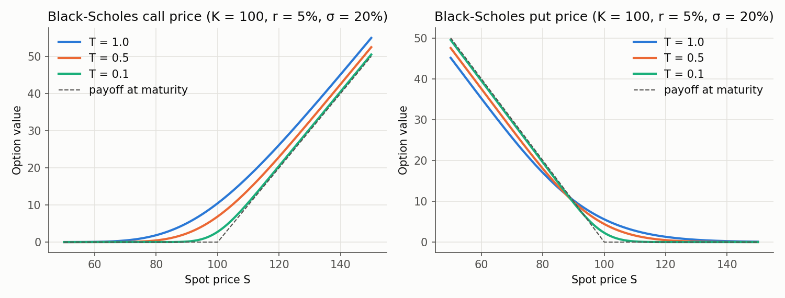
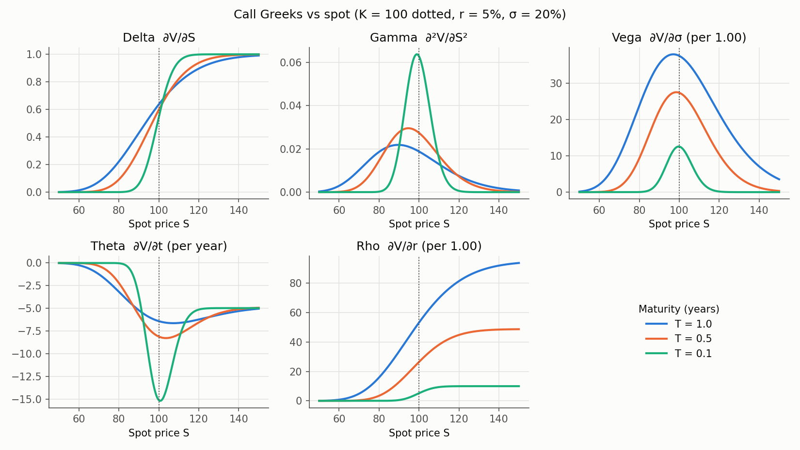

# Chapter 02: The Black–Scholes Formula and the Greeks

In Chapter 01 we showed that an option's price is its discounted expected payoff under
the risk-neutral measure, and we estimated one with five random draws. For a European
call or put on a stock following geometric Brownian motion, that expectation can be
computed **exactly**. The result is the Black–Scholes formula.

In this project the formula is the **benchmark**: every Monte Carlo pricer we build
must reproduce it to within 3 standard errors before we trust the pricer on anything
the formula can't handle.

**Contents**

1. [What problem this solves](#1-what-problem-this-solves)
2. [The model and where it comes from](#2-the-model-and-where-it-comes-from)
3. [Deriving the formula](#3-deriving-the-formula)
4. [The inputs](#4-the-inputs)
5. [Reading the formula term by term](#5-reading-the-formula-term-by-term)
6. [The Greeks](#6-the-greeks)
7. [Code walkthrough](#7-code-walkthrough)
8. [Results](#8-results)
9. [Common pitfalls](#9-common-pitfalls)
10. [Interview questions](#10-interview-questions)
11. [Exercises](#11-exercises)

---

## 1. What problem this solves

Fischer Black, Myron Scholes and Robert Merton published this formula in 1973. It
became the basis of the modern options market and won a Nobel Prize in 1997. Today
it's used in four main ways:

- **As a quoting language.** Traders rarely quote option prices directly. They quote
  the **implied volatility**: the $\sigma$ that makes the Black–Scholes price equal the
  market price (§4). "The 3-month at-the-money call is trading at 18 vol" is a
  complete price quote.
- **For hedging.** The Greeks (§6) tell a trader how many shares to hold to offset an
  option's risk, and how that hedge will drift.
- **For risk reports.** Banks add up the Greeks of every position to see how exposed
  the whole book is to moves in prices, volatility and rates.
- **As a benchmark and a building block.** Numerical methods are checked against it,
  and in Chapter 05 it becomes a *control variate* that shrinks Monte Carlo error.

Everyone knows the model's assumptions are wrong. Volatility isn't constant, and
prices jump. The formula is still the common reference point everything else is
measured against.

---

## 2. The model and where it comes from

### 2.1 Assumptions

1. The stock follows **geometric Brownian motion** (GBM) with constant drift $\mu$ and
   constant volatility $\sigma$.
2. The risk-free rate $r$ is constant.
3. The stock pays no dividends.
4. You can trade continuously, in any fraction of a share, with no transaction costs,
   and you can borrow or lend at $r$ and short-sell freely.
5. There's no arbitrage.

Assumptions 4–5 make the replication argument of Chapter 01 §6 work in continuous
time. Assumptions 1–3 fix the distribution of $S_T$.

### 2.2 GBM as a stochastic differential equation

Chapter 01 wrote GBM as $S_t = S_0\exp\big((\mu - \tfrac12\sigma^2)t + \sigma W_t\big)$.
It's usually stated as a rule for tiny time steps instead:

$$
dS_t = \mu\,S_t\,dt + \sigma\,S_t\,dW_t
$$

- $dS_t$: the change in the stock price over a tiny interval $dt$.
- $dW_t$: the Brownian increment over that interval, $\sim N(0, dt)$, so typically of
  size $\sqrt{dt}$.

Divide by $S_t$: the **percentage return** $dS_t/S_t$ over $dt$ has mean $\mu\,dt$ and
standard deviation $\sigma\sqrt{dt}$. The drift sets the average return and the
volatility sets its noise. Both are proportional to the current price, which is what
"geometric" means.

### 2.3 Solving it: Itô's lemma in one page

We want a formula for $S_T$. Ordinary calculus would say $d(\ln S) = dS/S$, giving
$\ln S_T = \ln S_0 + \mu T + \sigma W_T$. **That's wrong**, and the reason is the most
important idea in stochastic calculus.

Expand $f(S) = \ln S$ in a Taylor series to **second** order:

$$
d(\ln S) = f'(S)\,dS + \tfrac12 f''(S)\,(dS)^2 = \frac{dS}{S} - \frac{1}{2}\frac{(dS)^2}{S^2}.
$$

In ordinary calculus $(dS)^2$ is negligible: it's of order $dt^2$. Here it isn't:

$$
(dS)^2 = \sigma^2 S^2 (dW)^2 + (\text{terms of order } dt^{3/2} \text{ and } dt^2) \approx \sigma^2 S^2\,dt,
$$

because $dW \sim \sqrt{dt}$, so $(dW)^2 \sim dt$, the same size as the drift term.

**Why exactly $(dW)^2 = dt$?** Chop $[0, T]$ into $N$ steps. The sum of squared
increments is $\sum_i (\sqrt{\Delta t}\,Z_i)^2 = \Delta t\sum_i Z_i^2 = T\cdot\frac1N\sum_i Z_i^2 \to T\cdot\mathbb{E}[Z^2] = T$
by the law of large numbers. The squared increments add up to something
**non-random**, as if each were exactly $\Delta t$. (This is called the *quadratic
variation* of Brownian motion.)

Substituting $dS/S = \mu\,dt + \sigma\,dW$ and $(dS)^2/S^2 = \sigma^2 dt$:

$$
d(\ln S_t) = \big(\mu - \tfrac12\sigma^2\big)\,dt + \sigma\,dW_t
\quad\Longrightarrow\quad
S_T = S_0\exp\!\Big(\big(\mu - \tfrac12\sigma^2\big)T + \sigma W_T\Big).
$$

That's where the $-\frac12\sigma^2$ in Chapter 01 comes from. The general rule
(**Itô's lemma**) is: *Taylor-expand to second order and replace $(dW)^2$ by $dt$.*

### 2.4 Under the risk-neutral measure

Under $\mathbb{Q}$ every asset grows on average at $r$ (Chapter 01 §6.4), so
$\mu$ becomes $r$. Using $W_T = \sqrt T Z$ with $Z \sim N(0, 1)$:

$$
S_T = S_0\exp\!\Big(\big(r - \tfrac12\sigma^2\big)T + \sigma\sqrt T\,Z\Big).
$$

So $\ln S_T$ is normal with mean $\ln S_0 + (r - \frac12\sigma^2)T$ and standard
deviation $\sigma\sqrt T$. Everything below follows from this one line.

---

## 3. Deriving the formula

We need $C = e^{-rT}\,\mathbb{E}^{\mathbb{Q}}\big[\max(S_T - K, 0)\big]$.

**Step 1: split the payoff.** Write $\mathbf 1\{S_T > K\}$ for the *indicator*: 1 if
the call is exercised, 0 if not. Then $\max(S_T - K, 0) = S_T\,\mathbf 1\{S_T > K\} - K\,\mathbf 1\{S_T > K\}$, so

$$
C = e^{-rT}\,\mathbb{E}\big[S_T\,\mathbf 1\{S_T > K\}\big] \;-\; K e^{-rT}\,\mathbb{Q}(S_T > K).
$$

(The expectation of an indicator is a probability.)

**Step 2: probability of exercise.** Taking logs of the expression in §2.4,

$$
S_T > K \iff \ln S_0 + \big(r - \tfrac12\sigma^2\big)T + \sigma\sqrt T Z > \ln K
\iff Z > -d_2,
$$

where

$$
d_2 = \frac{\ln(S_0/K) + \big(r - \tfrac12\sigma^2\big)T}{\sigma\sqrt T}.
$$

The normal distribution is symmetric, so $P(Z > -d_2) = P(Z < d_2) = N(d_2)$. Here
$N(\cdot)$ is the standard normal CDF (written $\Phi$ in Chapter 01; $N$ is the
finance convention).

**Step 3: the stock term.** Let $\varphi(z) = e^{-z^2/2}/\sqrt{2\pi}$ be the standard
normal pdf, and write $a = \sigma\sqrt T$ to keep the algebra short:

$$
\mathbb{E}\big[S_T\,\mathbf 1\{Z > -d_2\}\big]
= S_0\,e^{(r - \frac12\sigma^2)T}\int_{-d_2}^{\infty} e^{a z}\,\varphi(z)\,dz.
$$

Complete the square: $az - \frac{z^2}{2} = -\frac{(z - a)^2}{2} + \frac{a^2}{2}$, so
$e^{az}\varphi(z) = e^{a^2/2}\,\varphi(z - a)$. Since $a^2/2 = \frac12\sigma^2T$ cancels the
$-\frac12\sigma^2 T$ in front,

$$
= S_0\,e^{rT}\int_{-d_2}^{\infty}\varphi(z - a)\,dz
= S_0\,e^{rT}\,P(Z > -d_2 - a)
= S_0\,e^{rT}\,N(d_1),
\qquad d_1 = d_2 + \sigma\sqrt T.
$$

**Step 4: put it together.** Multiply by $e^{-rT}$:

$$
\boxed{\;C = S_0\,N(d_1) - K e^{-rT}\,N(d_2)\;}
\qquad
d_{1,2} = \frac{\ln(S_0/K) + \big(r \pm \tfrac12\sigma^2\big)T}{\sigma\sqrt T}
$$

**The put** follows from put–call parity $C - P = S_0 - Ke^{-rT}$, using
$1 - N(x) = N(-x)$:

$$
\boxed{\;P = K e^{-rT}\,N(-d_2) - S_0\,N(-d_1)\;}
$$

**Another route.** Black and Scholes originally got the same answer by building a
riskless portfolio of option and stock. That leads to a partial differential
equation (the **Black–Scholes PDE**) which the price must satisfy:

$$
\frac{\partial V}{\partial t} + \tfrac12\sigma^2 S^2\frac{\partial^2 V}{\partial S^2} + rS\frac{\partial V}{\partial S} - rV = 0.
$$

Solving the PDE and taking the expectation give the same formula. (The theorem linking
them is called Feynman–Kac.) We come back to the PDE in §6.7, because it's a
statement about the Greeks.

---

## 4. The inputs

| Symbol | Name | Units | Observed? | Raise it → call | Raise it → put |
|---|---|---|---|:---:|:---:|
| $S$ ($S_0$) | spot price | currency | yes, on screen | ↑ | ↓ |
| $K$ | strike | currency | yes, in the contract | ↓ | ↑ |
| $T$ | time to maturity | years | yes, from the calendar | ↑ | usually ↑ (*) |
| $r$ | risk-free rate | decimal per year, continuous | yes, from government or interbank rates | ↑ | ↓ |
| $\sigma$ | volatility | decimal per $\sqrt{\text{year}}$ | **no** | ↑ | ↑ |

(*) A deep in-the-money European put can lose value with more time: you're waiting
longer to receive $K$, and waiting costs interest. Look at the blue $T = 1$ curve in
the put panel of the price figure in §8: it sits *below* the payoff for small $S$.
(At $S = 50$ the put is worth 45.13 against a payoff of 50.) An American put could be
exercised early to avoid this, which is why American puts need their own method
(Chapter 12).

**Some intuition for each direction:**

- **Higher $r$ helps calls:** paying $K$ later costs less in today's money.
  It hurts puts for the mirror reason: receiving $K$ later is worth less.
- **Higher $\sigma$ helps both:** the Jensen argument from Chapter 01 §3.2. More spread
  means bigger wins, while the loss is capped at the premium.
- **Missing input: $\mu$.** The stock's expected return doesn't appear. Two investors
  who disagree completely about where the stock is heading still agree on the option
  price, because both can replicate it.

**Implied volatility.** Four inputs can be read off a screen; $\sigma$ can't. Since the
price increases with $\sigma$ (vega > 0, §6.3), each market price matches exactly one
$\sigma$. That number is the **implied volatility**. If Black–Scholes were exactly
right, every option on the same stock would show the same implied vol. In reality it
varies with strike and maturity (the "volatility smile"), and that's the evidence
that drives the Heston and jump models in Chapters 10–11.

---

## 5. Reading the formula term by term

Take the standard example: $S = K = 100$, $T = 1$, $r = 5\%$, $\sigma = 20\%$.

| Piece | Formula | Value | Meaning |
|---|---|---:|---|
| total volatility | $\sigma\sqrt T$ | 0.20 | standard deviation of $\ln S_T$ |
| $d_2$ | $\frac{\ln(S/K) + (r - \sigma^2/2)T}{\sigma\sqrt T}$ | 0.15 | how many standard deviations $S_T$ is expected to finish above $K$ (in log terms, under $\mathbb{Q}$) |
| $d_1$ | $d_2 + \sigma\sqrt T$ | 0.35 | the same distance, shifted by one total volatility |
| $N(d_2)$ | | 0.5596 | **risk-neutral probability that the call is exercised** |
| $N(d_1)$ | | 0.6368 | the call's **delta**: shares needed to hedge it |
| $Ke^{-rT}$ | | 95.12 | today's value of the strike paid at $T$ |
| $Ke^{-rT}N(d_2)$ | | 53.23 | today's value of the *expected* strike payment |
| $S\,N(d_1)$ | | 63.68 | today's value of the stock you *expect* to receive |
| $C$ | difference | **10.45** | |

**Reading 1: "what you get minus what you pay".** Exercising a call means paying $K$
and receiving a share, but only if $S_T > K$.

- **$Ke^{-rT}N(d_2)$** is the present value of the strike payment: $K$, times the
  probability you actually pay it, discounted.
- **$S\,N(d_1)$** is the present value of the share you receive, counting only the
  scenarios where you exercise. It's *not* $S\,N(d_2)$, because in the scenarios
  where you exercise the stock tends to be high, so the share is worth more than its
  average. The higher weight $N(d_1) > N(d_2)$ captures that.

**Reading 2: the replicating portfolio.** Black–Scholes is the binomial replication
of Chapter 01 §6.3, done continuously. The formula literally tells you the hedge:

$$
C = \underbrace{N(d_1)}_{\text{shares held}}\times S \;-\; \underbrace{Ke^{-rT}N(d_2)}_{\text{cash borrowed}}.
$$

Hold 0.6368 shares (worth 63.68), borrow 53.23, and your net investment is 10.45. In
the binomial example it was 2/3 share and 57.07 borrowed; this is the same idea with
infinitely many tiny steps, the portfolio rebalanced as the stock moves.

**Reading 3: in forward terms.** Let $F = S e^{rT}$ be the **forward price**, the
price agreed today for delivery at $T$. Then
$C = e^{-rT}\big[F\,N(d_1) - K\,N(d_2)\big]$ with
$d_{1,2} = \big[\ln(F/K) \pm \frac12\sigma^2T\big]/(\sigma\sqrt T)$. Now $r$ only does
two jobs: setting the forward and discounting. What's left is the option-specific
part: how far the forward is from the strike, measured in units of total volatility
$\sigma\sqrt T$.

**The put, read the same way:** $P = Ke^{-rT}N(-d_2) - S\,N(-d_1)$. You *receive*
$K$ and *give up* a share, in the scenarios $S_T < K$, which have probability
$N(-d_2) = 1 - N(d_2)$.

**Sanity checks on the limits.** A good formula should behave sensibly at the edges:

| Limit | What happens to $d_1, d_2$ | Call becomes | Why that's right |
|---|---|---|---|
| $\sigma \to 0$ | $\pm\infty$ depending on sign of $\ln(S/K) + rT$ | $\max(S - Ke^{-rT}, 0)$ | no randomness: $S_T = Se^{rT}$ for sure |
| $T \to 0$ | $\pm\infty$ depending on $S \gtrless K$ | $\max(S - K, 0)$ | the payoff |
| $S \to \infty$ | $+\infty$ | $S - Ke^{-rT}$ | certain to exercise: it's a forward |
| $S \to 0$ | $-\infty$ | $0$ | certain not to exercise |

With the standard inputs and $\sigma = 10^{-6}$, the code returns 4.8771, which is
$100 - 100e^{-0.05}$ as the first row predicts.

---

## 6. The Greeks

The **Greeks** are the partial derivatives of the price with respect to its inputs.
They answer "if this input moves a little, how much does the option's value move?"
They're named (mostly) after Greek letters.

### 6.1 One trick that does all the algebra

Every Greek derivation uses the identity

$$
S\,\varphi(d_1) = K e^{-rT}\,\varphi(d_2).
$$

*Proof:* $\varphi(d_1)/\varphi(d_2) = e^{-(d_1^2 - d_2^2)/2} = e^{-(d_1 - d_2)(d_1 + d_2)/2}$.
Here $d_1 - d_2 = \sigma\sqrt T$ and $d_1 + d_2 = 2[\ln(S/K) + rT]/(\sigma\sqrt T)$, so the
ratio is $e^{-\ln(S/K) - rT} = Ke^{-rT}/S$. ∎

Why it matters: differentiating $C = S N(d_1) - Ke^{-rT}N(d_2)$ with respect to any
input $x$ gives two "chain rule" terms, $S\varphi(d_1)\,\partial d_1/\partial x$ and
$-Ke^{-rT}\varphi(d_2)\,\partial d_2/\partial x$. By the identity these combine into
$S\varphi(d_1)\,\partial(d_1 - d_2)/\partial x = S\varphi(d_1)\,\partial(\sigma\sqrt T)/\partial x$,
which is **zero unless $x$ is $\sigma$ or $T$**. That's why the Greeks are so tidy.

### 6.2 Delta: sensitivity to the stock price

$$
\Delta_{\text{call}} = \frac{\partial C}{\partial S} = N(d_1), \qquad \Delta_{\text{put}} = N(d_1) - 1.
$$

The chain-rule terms cancel (because $d_1 - d_2$ doesn't depend on $S$), leaving
only the explicit $N(d_1)$.

- **Range:** call delta is in $(0, 1)$ and put delta is in $(-1, 0)$.
- **Meaning:** if $S$ rises by 1, the call gains about $\Delta$. It's also the number of
  shares in the replicating portfolio. A trader who **sells** a call buys $\Delta$
  shares to be **delta-neutral**.
- **Example:** $\Delta = 0.6368$. If the stock goes 100 → 101, the call gains about 0.64.
- **At the money, delta isn't 0.5.** $d_1 = (r + \frac12\sigma^2)T/(\sigma\sqrt T) > 0$
  when $S = K$, so delta is a bit above 0.5. The stock's drift under $\mathbb{Q}$ and
  the skew of the lognormal both tilt it upward.
- **Shape:** an S-curve in $S$ that sharpens into a step at $K$ as $T \to 0$ (see the
  Greeks figure in §8).

### 6.3 Gamma: how fast delta changes

$$
\Gamma = \frac{\partial^2 V}{\partial S^2} = \frac{\varphi(d_1)}{S\,\sigma\sqrt T} \quad\text{(same for call and put)}.
$$

- **Why the same?** Parity says $C - P = S - Ke^{-rT}$, a straight line in $S$. Its
  second derivative is zero, so $\Gamma_C = \Gamma_P$.
- **Meaning:** the curvature of the price. Gamma tells a hedger how quickly the hedge
  goes stale: high gamma means rebalancing often.
- **Always positive** for a long option: the value curve is convex (it bends upward),
  as in the price figure.
- **Shape:** peaks near the strike. As $T \to 0$ it becomes a tall narrow spike,
  because delta is jumping from 0 to 1 over a tiny range of $S$. Short-dated
  at-the-money options are the hardest to hedge.
- **Example:** $\Gamma = 0.0188$. After a 1-point stock rise, delta becomes about
  $0.6368 + 0.0188 = 0.6556$.

### 6.4 Vega: sensitivity to volatility

$$
\nu = \frac{\partial V}{\partial \sigma} = S\,\varphi(d_1)\,\sqrt T \quad\text{(same for call and put)}.
$$

Using §6.1, $\partial C/\partial\sigma = S\varphi(d_1)\,\partial(\sigma\sqrt T)/\partial\sigma = S\varphi(d_1)\sqrt T$.
Parity doesn't contain $\sigma$, so the put has the same vega.

- Vega isn't actually a Greek letter. The name stuck anyway.
- **Units:** our function returns the change per **1.00** of $\sigma$ (100 vol points).
  Traders quote it per **1 vol point** (σ from 20% to 21%), which is $\nu/100$.
- **Example:** $\nu = 37.52$, so 0.375 per vol point: the call goes from 10.45 to about
  10.83 if volatility moves from 20% to 21%.
- **Shape:** largest near the money and growing like $\sqrt T$. Long-dated options are
  most exposed to volatility.

### 6.5 Theta: the cost of time passing

$$
\Theta_{\text{call}} = -\frac{S\varphi(d_1)\sigma}{2\sqrt T} - rKe^{-rT}N(d_2), \qquad
\Theta_{\text{put}} = -\frac{S\varphi(d_1)\sigma}{2\sqrt T} + rKe^{-rT}N(-d_2).
$$

**Sign convention:** theta is the change in value as **calendar time passes**, which
means $T$ shrinks: $\Theta = -\partial V/\partial T$.

- **First term (both options):** loss of "optionality". With less time left, there's
  less chance of a big favourable move. It's always negative, and largest at the money
  near expiry.
- **Second term:** the interest effect. A call holder will pay $K$; as time passes
  that payment gets closer, so its present value rises, which hurts. A put holder
  will *receive* $K$, so this term helps, and can make deep in-the-money European put
  theta **positive** (it's +4.74 per year at $S = 50$ in our example).
- **Units:** per **year**. Divide by 365 for "per calendar day" (some desks use 252
  trading days).
- **Example:** $\Theta_{\text{call}} = -6.414$ per year, or **−0.0176 per day**.
  Holding the call overnight costs about 1.8 cents, all else equal.

### 6.6 Rho: sensitivity to the interest rate

$$
\rho_{\text{call}} = KTe^{-rT}N(d_2), \qquad \rho_{\text{put}} = -KTe^{-rT}N(-d_2).
$$

- **Meaning:** a call holder is effectively short cash (the borrowed $Ke^{-rT}N(d_2)$
  in Reading 2), so higher rates lower the value of what they owe. Rho is that
  borrowing times $T$.
- **Units:** per 1.00 change in $r$; divide by 100 for per 1% (100 basis points).
- **Example:** $\rho = 53.23$, or 0.53 per 1%. For equity options, rho is usually the
  least important Greek.

### 6.7 How the Greeks fit together

**Taylor expansion of the P&L.** For small moves in every input:

$$
dV \approx \Delta\,dS + \tfrac12\Gamma\,(dS)^2 + \nu\,d\sigma + \Theta\,dt + \rho\,dr.
$$

*Example:* one day passes and the stock moves 100 → 101:
$0.6368(1) + \tfrac12(0.0188)(1)^2 - 6.414/365 = 0.6286$. Repricing exactly with the
formula gives 0.6284. The Greeks explain the move almost perfectly.

**The Black–Scholes PDE as a statement about Greeks.** The PDE from §3 reads:

$$
\Theta + \tfrac12\sigma^2S^2\,\Gamma + rS\,\Delta = rV.
$$

Check with our numbers: $-6.414 + \tfrac12(0.04)(100^2)(0.018762) + 0.05(100)(0.63683) = 0.5225 = 0.05 \times 10.4506$. ✓

For a **delta-hedged** option (long the option, short $\Delta$ shares, financed at
$r$), the $\Delta$ and $rV$ terms are exactly the financing, and what's left is

$$
\underbrace{\tfrac12\Gamma\,(dS)^2}_{\text{gain from moves}} \quad\text{vs.}\quad \underbrace{\Theta\,dt}_{\text{cost of waiting}}.
$$

Long options earn money when the stock moves a lot (gamma) and pay for that by losing
value every day (theta). If the stock moves exactly as much as $\sigma$ predicts, the
two cancel. This **gamma–theta trade-off** is the core of option trading.

### 6.8 Summary of signs (long position)

| | Call | Put | Same for both? |
|---|:---:|:---:|:---:|
| Delta | + | − | no (differ by 1) |
| Gamma | + | + | yes |
| Vega | + | + | yes |
| Theta | − | usually − | no |
| Rho | + | − | no |

---

## 7. Code walkthrough

### `mc_engine/analytics/black_scholes.py`

Six public functions, all with the same first five arguments `(S, K, T, r, sigma)`:

| Function | Returns | `kind` argument? |
|---|---|---|
| `price` | option value | yes: `"call"` or `"put"` |
| `delta` | $\partial V/\partial S$ | yes |
| `gamma` | $\partial^2 V/\partial S^2$ | no: same for both |
| `vega` | $\partial V/\partial\sigma$ per 1.00 | no: same for both |
| `theta` | $\partial V/\partial t$ per year | yes |
| `rho` | $\partial V/\partial r$ per 1.00 | yes |

Use it as:

```python
from mc_engine.analytics import black_scholes as bs

bs.price(100, 100, 1.0, 0.05, 0.2)                 # 10.4506
bs.price(100, 100, 1.0, 0.05, 0.2, kind="put")     # 5.5735
bs.price(100, [90, 100, 110], 1.0, 0.05, 0.2)      # array([16.6994, 10.4506, 6.0401])
```

Design points:

- **One formula for calls and puts.** `_phi(kind)` returns $\phi = +1$ (call) or $-1$
  (put), and the code uses the unified form
  $V = \phi\,[S\,N(\phi d_1) - Ke^{-rT}N(\phi d_2)]$. Put $\phi = -1$ in and you get the
  put formula of §3. Delta, theta and rho use the same trick. Writing each formula once
  means a fix can't reach one option type and miss the other.
- **`_prepare`** converts every input to a NumPy float array, checks that $S, K, T,
  \sigma > 0$, and computes $d_1, d_2$. A zero $T$ or $\sigma$ would otherwise divide by
  zero and silently return `nan`/`inf`, which is worse than an error. ($r$ may be
  negative; some currencies have had negative rates.)
- **Vectorised.** Because everything is NumPy arithmetic, you can pass arrays of any
  inputs and they broadcast together. Pricing a whole grid of strikes costs one call.
- `norm.cdf` and `norm.pdf` from `scipy.stats` are $N(\cdot)$ and $\varphi(\cdot)$.

### `tests/test_black_scholes.py`

| Test | What it proves |
|---|---|
| `test_standard_example` | 10.4506 / 5.5735 for $S = K = 100$, $T = 1$, $r = 5\%$, $\sigma = 20\%$ |
| `test_hull_bsm_example` | matches Hull's *Options, Futures and Other Derivatives* (4.76 / 0.81) |
| `test_hull_greeks_example` | matches Hull's worked Greeks example: price, Δ, Γ, ν, Θ, ρ |
| `test_put_call_parity_price` | $C - P = S - Ke^{-rT}$ on 200 random input sets |
| `test_put_call_parity_greeks` | the derivatives of parity: $\Delta_C - \Delta_P = 1$, $\Theta_C - \Theta_P = -rKe^{-rT}$, $\rho_C - \rho_P = TKe^{-rT}$ |
| `test_greeks_satisfy_black_scholes_pde` | $\Theta + \frac12\sigma^2S^2\Gamma + rS\Delta = rV$ for calls and puts |
| `test_greeks_match_finite_differences` | each Greek ≈ a numerical derivative of `price`, e.g. $(V(S+h) - V(S-h))/2h$ |
| `test_monte_carlo_within_3_standard_errors` | a $10^6$-path simulation of $S_T$ under $\mathbb{Q}$ agrees with the formula for 3 strikes, calls and puts |
| `test_rejects_*` | bad inputs raise `ValueError` instead of returning `nan` |

The finite-difference test is the strongest: it checks every Greek formula
independently against the price. Its tolerance is *relative* (1e-4), because a central
difference has error proportional to $h^2$. During development, vega at $\sigma = 5\%$
differed from the finite difference by 3e-5. Shrinking $h$ by 10× shrank that by
100×, which proves it was the finite difference's error and not the formula's.

### `docs/figures/make_ch02.py`

Regenerates both figures and prints the tables in §8. Run it from the repo root with
`python -m docs.figures.make_ch02`.

---

## 8. Results

### 8.1 Against textbook values

| Case | Quantity | Textbook (Hull) | Ours |
|---|---|---:|---:|
| $S=42, K=40, T=0.5, r=10\%, \sigma=20\%$ | call / put | 4.76 / 0.81 | 4.7594 / 0.8086 |
| $S=49, K=50, T=20/52, r=5\%, \sigma=20\%$ | call price | 2.40 | 2.4005 |
| | delta | 0.522 | 0.5216 |
| | gamma | 0.066 | 0.0655 |
| | vega | 12.1 | 12.1055 |
| | theta (per year) | −4.31 | −4.3053 |
| | rho | 8.91 | 8.9070 |

### 8.2 The standard example: $S = K = 100$, $T = 1$, $r = 5\%$, $\sigma = 20\%$

| | Call | Put |
|---|---:|---:|
| Price | 10.4506 | 5.5735 |
| Delta | 0.6368 | −0.3632 |
| Gamma | 0.0188 | 0.0188 |
| Vega (per 1.00) | 37.5240 | 37.5240 |
| Theta (per year) | −6.4140 | −1.6579 |
| Rho (per 1.00) | 53.2325 | −41.8905 |

Check parity: $10.4506 - 5.5735 = 4.8771 = 100 - 100e^{-0.05}$; $\Delta_C - \Delta_P = 1$. ✓

### 8.3 Formula vs. simulation

This is Chapter 01's five-draw example done with a million draws (seed 42):

| Option | K | Black–Scholes | MC ($10^6$ paths) | SE | (MC − BS)/SE |
|---|---:|---:|---:|---:|---:|
| call | 80 | 24.5888 | 24.5953 | 0.0192 | +0.34 |
| call | 100 | 10.4506 | 10.4532 | 0.0147 | +0.18 |
| call | 120 | 3.2475 | 3.2500 | 0.0087 | +0.29 |
| put | 80 | 0.6872 | 0.6898 | 0.0027 | +0.98 |
| put | 100 | 5.5735 | 5.5723 | 0.0087 | −0.14 |
| put | 120 | 17.3950 | 17.3937 | 0.0148 | −0.09 |

All six are within 1 SE. Since the same 10⁶ draws are reused for every row, their
errors are correlated (all three calls are slightly high), so the six rows aren't
independent checks.

### 8.4 Figures



*Prices for three maturities, with the payoff dashed. The gap between the curve
and the payoff is the **time value**. It's largest at the strike and shrinks toward
zero as $T \to 0$. Note the $T = 1$ put dipping below its payoff for low $S$ (§4).*



*Call Greeks for three maturities. Delta steepens into a step and gamma into a spike as
expiry nears; vega grows with $T$; theta is most negative at the money just before
expiry and tends to $-rKe^{-rT}$ deep in the money; rho grows with $T$.*

---

## 9. Common pitfalls

1. **Units of theta, vega and rho.** Our functions return per year and per 1.00;
   trading screens often show per day and per 1%. Compare the wrong pair and you're off
   by 365× or 100×.
2. **Percent vs decimal.** `sigma=20` instead of `0.2` gives a call worth almost $S$,
   with no error message.
3. **$T$ in days.** `T=30` means 30 years. Use `30/365`.
4. **Swapping $d_1$ and $d_2$**, or forgetting the minus signs in the put. The parity
   test catches both.
5. **Calling the formula with $T = 0$ or $\sigma = 0$.** That's division by zero. At
   maturity, use the payoff instead. Our code raises an error rather than returning `nan`.
6. **Interpreting $N(d_2)$ as the real chance of exercise.** It's the *risk-neutral*
   probability. The real one depends on $\mu$, which the formula deliberately ignores.
7. **Interpreting $N(d_1)$ as a probability of exercise.** It's the delta. (It is a
   probability under a different measure, the one that uses the stock as the unit of
   account, but not under $\mathbb{Q}$.)
8. **Applying it outside its assumptions.** Dividends, American exercise, path
   dependence, stochastic volatility and jumps all break the formula. That's why we're
   building a Monte Carlo engine.

---

## 10. Interview questions

**1. Interpret $N(d_1)$ and $N(d_2)$.**
$N(d_2)$ is the risk-neutral probability that the call finishes in the money, so
$Ke^{-rT}N(d_2)$ is the present value of the expected strike payment. $N(d_1)$ is the
call's delta: the number of shares in the replicating portfolio, so $SN(d_1)$ is the
present value of the stock received on exercise. $N(d_1) > N(d_2)$ because, in the
scenarios where you exercise, the stock tends to be high.

**2. Why doesn't the stock's expected return $\mu$ appear in the formula?**
Because the option can be replicated by trading the stock and cash. The replication
cost depends only on how much the stock can move ($\sigma$), not on which way it's
expected to go. So the price is computed under $\mathbb{Q}$, where every asset earns $r$.

**3. Which Greeks are the same for a call and a put with the same strike and expiry, and why?**
Gamma and vega. Put–call parity says $C - P = S - Ke^{-rT}$. The right side is linear
in $S$ (so its second derivative is zero) and doesn't involve $\sigma$, so the call and
put have identical second $S$-derivatives and identical $\sigma$-derivatives. Deltas
differ by exactly 1.

**4. Is the delta of an at-the-money call 0.5?**
Slightly more. At $S = K$, $d_1 = (r + \frac12\sigma^2)\sqrt T/\sigma > 0$, so
$N(d_1) > 0.5$: 0.637 in our example. It only tends to 0.5 as $T \to 0$.

**5. What happens to gamma and theta of an at-the-money option as expiry approaches,
and how are they related?**
Both blow up in size (gamma like $1/\sqrt T$, theta also like $1/\sqrt T$). The
Black–Scholes PDE links them: for a delta-hedged position, $\Theta \approx -\frac12\sigma^2S^2\Gamma$
(plus interest). A long-gamma position gains when the stock moves and pays for it
through time decay. The two balance exactly when realised volatility equals $\sigma$.

---

## 11. Exercises

**Exercise 1: price by hand.** For $S = 42$, $K = 40$, $T = 0.5$, $r = 10\%$, $\sigma = 20\%$,
compute $d_1$, $d_2$, the call and the put using only a calculator and a normal
table. Then check with `bs.price`.

<details><summary>Check your answers</summary>

$d_1 = 0.7693$, $d_2 = 0.6278$, $N(d_1) = 0.7791$, $N(d_2) = 0.7349$, $C = 4.76$, $P = 0.81$.
</details>

**Exercise 2: implied volatility (coding).** Write
`implied_vol(price, S, K, T, r, kind="call")` that finds $\sigma$ by **bisection** on
$[10^{-4}, 5]$: repeatedly halve the interval, keeping the half where
`bs.price(...) - price` changes sign. Stop when the interval is narrower than $10^{-8}$.
(a) Why does vega > 0 guarantee bisection finds a unique answer?
(b) Test it: `implied_vol(10.4506, 100, 100, 1, 0.05)` should give about 0.20.
(c) What happens if you pass a price below $\max(S - Ke^{-rT}, 0)$? Why does no
$\sigma$ exist then?

<details><summary>Hints</summary>

(a) Price is strictly increasing in $\sigma$, so at most one $\sigma$ hits any price,
and continuity guarantees one exists between the endpoints' prices.
(c) That's below the $\sigma \to 0$ limit in §5: such a price would be an arbitrage.
Your function should raise an error.
</details>

**Exercise 3: the Greeks as a P&L predictor.** You own the standard-example call. One
day later the stock is at 101 and implied volatility has risen to 21%.
(a) Estimate the change in value with $\Delta\,dS + \frac12\Gamma\,dS^2 + \nu\,d\sigma + \Theta\,dt$.
(b) Compute the exact change with `bs.price`.
(c) Which term contributed most? What would happen to the approximation's accuracy for
a 10-point stock move?

<details><summary>Check your answers</summary>

(a) $0.6368 + 0.0094 + 0.3752 - 0.0176 = 1.0039$. (b) $1.0006$.
(c) Delta (0.64), then vega (0.38). For larger moves the higher-order terms ignored by
the expansion grow, and the approximation gets worse. Try it.
</details>
