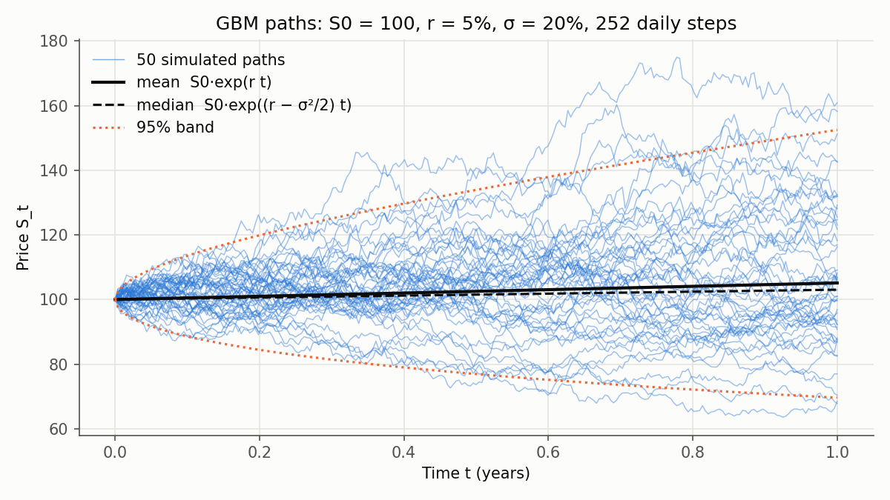
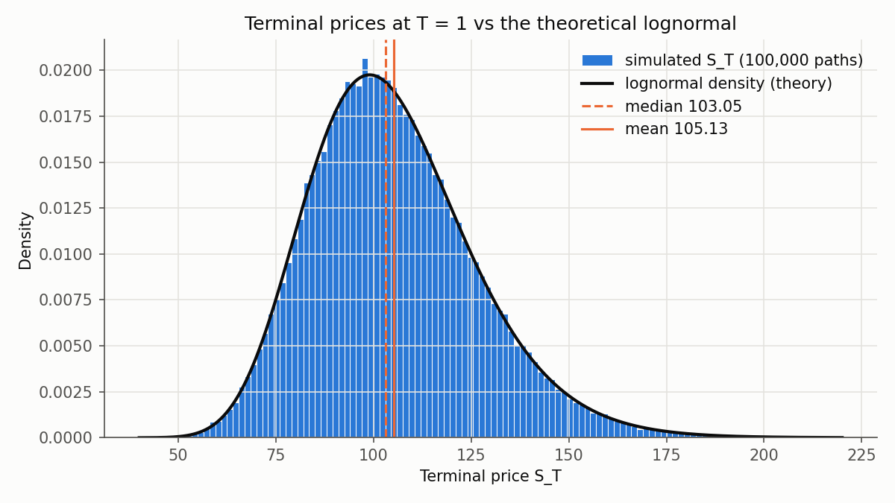
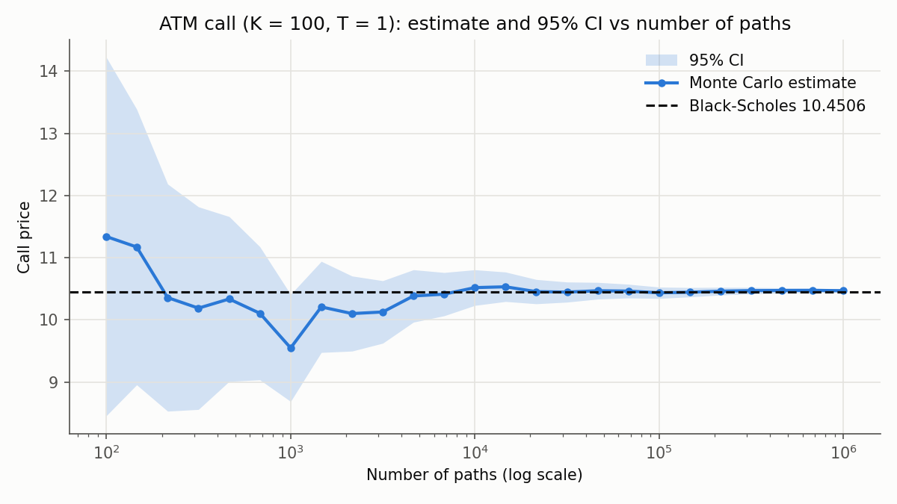

# Chapter 03: Simulating GBM and the First Monte Carlo Pricer

Chapter 01 gave the recipe: *simulate $S_T$ under $\mathbb{Q}$, average the discounted
payoffs*. Chapter 02 gave the exact answer for European options. This chapter builds
the machine: a stock-price **model** that generates paths, a **payoff** that turns
paths into cash flows, and an **engine** that turns cash flows into a price. Then we
show it reproduces Black–Scholes across a grid of strikes and maturities.

**Contents**

1. [What problem this solves](#1-what-problem-this-solves)
2. [Geometric Brownian motion](#2-geometric-brownian-motion)
3. [Where the −σ²/2 comes from: Itô's lemma, simply](#3-where-the-σ2-comes-from-itôs-lemma-simply)
4. [The exact discretisation](#4-the-exact-discretisation)
5. [From paths to a price](#5-from-paths-to-a-price)
6. [Code walkthrough](#6-code-walkthrough)
7. [Validation against Black–Scholes](#7-validation-against-blackscholes)
8. [Results](#8-results)
9. [Common pitfalls](#9-common-pitfalls)
10. [Interview questions](#10-interview-questions)
11. [Exercises](#11-exercises)

---

## 1. What problem this solves

Black–Scholes prices one kind of contract under one model. A bank needs Asian options,
barriers, baskets and callable notes, under models with stochastic volatility and
jumps. None of these has a formula. All of them have a price of the form
$e^{-rT}\mathbb{E}^{\mathbb{Q}}[\text{payoff}]$, and that expectation can always be
estimated by simulation.

So production pricing libraries are built around a **path simulator**. This chapter
builds the simplest one (GBM) and the engine around it. Everything later plugs into
the same engine: new models in `models/`, new contracts in `payoffs/`.

Because GBM + European payoff has a known answer, this is also where we **prove the
engine is correct** before trusting it on problems without a formula.

---

## 2. Geometric Brownian motion

### 2.1 The model

GBM says that, over a tiny time interval $dt$, the stock's **percentage return** is
a fixed drift plus Gaussian noise:

$$
\frac{dS_t}{S_t} = r\,dt + \sigma\,dW_t
\qquad\Longleftrightarrow\qquad
dS_t = r\,S_t\,dt + \sigma\,S_t\,dW_t
$$

- $S_t$: stock price at time $t$ (years).
- $r$: the drift. In the real world this would be the expected return $\mu$. For
  **pricing** we work under $\mathbb{Q}$, where it is the risk-free rate (Chapter 01 §6).
- $\sigma$: volatility, the standard deviation of returns per $\sqrt{\text{year}}$.
- $dW_t$: a Brownian increment, $\sim N(0, dt)$.

Over $dt$ the return has mean $r\,dt$ and standard deviation $\sigma\sqrt{dt}$.

**Why model percentage returns instead of price changes?** A \$1 move means something
very different for a \$5 stock than for a \$500 stock, but a 1% move means the same.
Modelling returns also guarantees the price stays positive. (Its flaws: real
volatility isn't constant and real prices jump. Chapters 10–11 address those.)

### 2.2 What the solution looks like

Section 3 shows that the SDE above solves to

$$
S_T = S_0\exp\!\Big(\big(r - \tfrac12\sigma^2\big)T + \sigma W_T\Big),
\qquad W_T = \sqrt T\,Z,\ Z \sim N(0, 1).
$$

So $\ln S_T$ is normal and $S_T$ is **lognormal**. With $S_0 = 100$, $r = 5\%$,
$\sigma = 20\%$, $T = 1$:

| Quantity | Formula | Value |
|---|---|---:|
| Mean of $S_T$ | $S_0e^{rT}$ | 105.13 |
| Median of $S_T$ | $S_0e^{(r - \sigma^2/2)T}$ | 103.05 |
| Std dev of $S_T$ | $S_0e^{rT}\sqrt{e^{\sigma^2T} - 1}$ | 21.24 |
| $\mathbb{Q}(S_T < S_0)$ | $N\big(-(r - \sigma^2/2)\sqrt T/\sigma\big)$ | 44.0% |

The **mean is above the median**: the distribution is skewed right. Prices can rise
without limit but can't fall below 0, so a few very large outcomes pull the average
up. The histogram in §8 shows this.

### 2.3 Volatility drag: the −σ²/2 in plain numbers

A stock goes up 10% and then down 10%. The average return is 0%, but
$100 \times 1.10 \times 0.90 = 99$. You **lost** 1%. In log terms:
$\ln 1.10 + \ln 0.90 = 0.0953 - 0.1054 = -0.0101$.

Ups and downs of equal size don't cancel when they multiply. A volatile asset's
*typical* (median) growth rate is lower than its *average* return. The gap is
$\frac12\sigma^2$: here $\sigma = 10\%$ per period over 2 periods gives
$2 \times \frac12(0.1)^2 = 0.01$. That's exactly the drag we saw.

That's all the $-\frac12\sigma^2$ is. **The mean of $S_T$ grows at $r$; the median, and
the log-price, grow at $r - \frac12\sigma^2$.** Itô's lemma is the tool that computes the
drag exactly.

---

## 3. Where the −σ²/2 comes from: Itô's lemma, simply

We know how $S$ moves; we want to know how $\ln S$ moves, because $\ln S$ turns
multiplication into addition. (Chapter 02 §2.3 has the same derivation; here it is
again, slowly.)

**Step 1: Taylor-expand to second order.** For any smooth $f$,
$df \approx f'(S)\,dS + \frac12 f''(S)\,(dS)^2$. With $f(S) = \ln S$, $f' = 1/S$ and $f'' = -1/S^2$:

$$
d(\ln S) = \frac{dS}{S} - \frac{1}{2}\frac{(dS)^2}{S^2}.
$$

**Step 2: ask how big $(dS)^2$ is.** In ordinary calculus you drop it, because
$(dS)^2 \propto dt^2$ is tiny compared with $dt$. But here

$$
\frac{(dS)^2}{S^2} = (r\,dt + \sigma\,dW)^2 = r^2dt^2 + 2r\sigma\,dt\,dW + \sigma^2(dW)^2.
$$

$dW$ is of size $\sqrt{dt}$, so the three terms have sizes $dt^2$, $dt^{3/2}$ and $dt$.
The first two vanish as $dt \to 0$; **the last doesn't**.

**Step 3: replace $(dW)^2$ with $dt$.** Over $n$ small steps,
$\sum (dW_i)^2 = dt\sum Z_i^2$, and by the law of large numbers that's $n\,dt\cdot\mathbb{E}[Z^2] = $ elapsed time.
Squared Brownian increments are individually random but add up to something
deterministic, so in the limit we can treat $(dW)^2$ as $dt$.

**Step 4: substitute.**

$$
d(\ln S) = \underbrace{r\,dt + \sigma\,dW}_{dS/S} - \tfrac12\sigma^2\,dt
= \big(r - \tfrac12\sigma^2\big)\,dt + \sigma\,dW.
$$

**Itô's lemma** in one sentence: *when you change variables in a random process,
keep the second-order Taylor term, because $(dW)^2 = dt$ is as big as the drift.* For
a concave function like $\ln$, that term is negative. It's the volatility drag of
§2.3.

---

## 4. The exact discretisation

### 4.1 Derivation

The log-price has **constant** drift and volatility: $d(\ln S) = (r - \frac12\sigma^2)\,dt + \sigma\,dW$.
Constant coefficients mean we can integrate exactly over any finite step $\Delta t$
(the "dt" in the code):

$$
\ln S(t + \Delta t) - \ln S(t) = \big(r - \tfrac12\sigma^2\big)\Delta t + \sigma\big(W(t+\Delta t) - W(t)\big).
$$

The Brownian increment is $N(0, \Delta t)$ and independent of everything before $t$
(Chapter 01 §5.2), so we can write it as $\sqrt{\Delta t}\,Z$ with a fresh
$Z \sim N(0, 1)$. Exponentiate:

$$
\boxed{\;S(t + \Delta t) = S(t)\,\exp\!\Big(\big(r - \tfrac12\sigma^2\big)\Delta t + \sigma\sqrt{\Delta t}\,Z\Big)\;}
$$

**Why "exact":** no approximation was made. Each step's log-increment has exactly the
right distribution, and the steps are independent, just like real Brownian increments.
So the simulated prices at the grid times have **exactly** the joint distribution of
true GBM, for any $\Delta t$, even one step of a whole year. A finer grid gives you
more points *on* the path, not a more accurate path.

**Consequence:** a European option only needs $S_T$, so **one step** ($\Delta t = T$)
prices it exactly. Multiple steps matter only for payoffs that look at the path, such as
Asians and barriers (Chapter 07).

**Hand example.** One trading day ($\Delta t = 1/252$), $S = 100$, $r = 5\%$,
$\sigma = 20\%$, and we draw $Z = 1.5$:

- drift part: $(0.05 - 0.02)/252 = 0.000119$
- shock part: $0.2 \times \sqrt{1/252} \times 1.5 = 0.018898$
- $S(t + \Delta t) = 100\,e^{0.019017} = 101.92$

Over one day the shock is about 160 times the drift. Day-to-day, stock prices are
almost pure noise.

### 4.2 The alternative: Euler's method, and why we don't use it

The generic way to simulate any SDE is the **Euler scheme**: treat $dS = rS\,dt + \sigma S\,dW$
as if it held for a finite step:

$$
S(t + \Delta t) = S(t)\big(1 + r\Delta t + \sigma\sqrt{\Delta t}\,Z\big).
$$

It's only right in the limit $\Delta t \to 0$. With finite steps it has two problems:

1. **Bias.** One Euler step makes $S_T$ *normal* instead of lognormal. Pricing the
   at-the-money call with 10⁶ paths gives 10.2022 against the true 10.4506: **19.6
   standard errors** off (table in §8.3). The bias falls as steps are added, roughly in
   proportion to $\Delta t$.
2. **Negative prices.** $1 + r\Delta t + \sigma\sqrt{\Delta t}Z < 0$ whenever $Z$ is
   very negative. With $\sigma = 80\%$ and one step of a year, that happens on 9.5% of
   paths.

For GBM, the exact scheme costs the same as Euler (one `exp` per step), so there's no
reason to use Euler. For models with no exact solution (Heston, Chapter 10), we'll
need Euler-type schemes, and the bias they cause will matter.

---

## 5. From paths to a price

Putting Chapter 01 together with the simulator:

1. Simulate $n$ paths $S^{(i)} = (S^{(i)}_{t_0}, \dots, S^{(i)}_{t_m})$ under $\mathbb{Q}$.
2. Evaluate the payoff on each path: $g(S^{(i)})$.
3. Discount: $X_i = e^{-rT}g(S^{(i)})$.
4. Estimate: $\hat V = \frac1n\sum X_i$, $\text{SE} = s/\sqrt n$, CI $= \hat V \pm 1.96\,\text{SE}$.

In code, steps 1, 2 and 3–4 are three separate pieces: the model, the payoff and the
engine. That's the architecture from Chapter 00.

---

## 6. Code walkthrough

### 6.1 `mc_engine/models/gbm.py`: `GBM`

```python
model = GBM(S0=100, r=0.05, sigma=0.2)
paths = model.simulate(n_paths=50, n_steps=252, T=1.0, rng=np.random.default_rng(2024))
paths.shape   # (50, 253): row = one path, column j = time j*T/252, column 0 = S0
```

- A **frozen dataclass**: it holds the three parameters and can't be modified after
  creation. `__post_init__` rejects $S_0 \le 0$ and $\sigma < 0$.
- `simulate` is fully **vectorised**, with no Python loop over paths or steps:
  1. draw all $Z$ at once, shape `(n_paths, n_steps)`;
  2. compute every log-increment $(r - \frac12\sigma^2)\Delta t + \sigma\sqrt{\Delta t}Z$
     in one array expression;
  3. `np.cumsum(..., axis=1)` adds them along each row, giving $\ln(S_t/S_0)$ at every
     grid time;
  4. `S0 * np.exp(...)` fills columns 1…m; column 0 is set to $S_0$.

  Adding logs rather than multiplying prices step by step is the same maths, but one
  `cumsum` replaces `n_steps` Python-level multiplications.
- The `rng` is passed in, never global, so the caller controls reproducibility.
- **Memory:** `n_paths × (n_steps + 1) × 8` bytes per array, and a few arrays exist at
  once. 10⁶ paths × 252 steps ≈ 2 GB per array, which is too much. For Europeans use
  `n_steps=1`; for path-dependent work, use fewer paths per batch (Chapter 13 covers
  batching).

### 6.2 `mc_engine/payoffs/european.py`: `European`

```python
European(K=100)(paths)               # call payoffs, shape (n_paths,)
European(K=100, kind="put")(paths)   # put payoffs
```

A payoff is an object you **call** on a paths array (that's what `__call__` does). It
reads only `paths[:, -1]`, the last column of every row, so it works with any model
and any number of steps. `K` and `kind` are stored in the dataclass, so the same
payoff object can be reused and printed (`European(K=100, kind='call')`).

### 6.3 `mc_engine/engine.py`: `price`

```python
from mc_engine.engine import price
res = price(GBM(100, 0.05, 0.2), European(100), T=1.0, n_paths=1_000_000)
res.price, res.std_error, res.ci_95, res.runtime_sec
```

`price` does steps 1–4 of §5 in four lines: seed a generator, call
`model.simulate`, apply `payoff`, discount with `model.r`, and hand the samples to
`PricingResult.from_samples` (Chapter 00), timing the whole thing.

It knows nothing about GBM or calls. Its type hints spell out the only things it
relies on:

- `Model`, a `Protocol`: "anything with an attribute `r` and a method
  `simulate(n_paths, n_steps, T, rng)`". `GBM` satisfies it without inheriting from
  anything. A Heston model will too.
- `Payoff`: "any callable from a paths array to a cash-flow array".

Defaults: `n_steps=1` (enough for Europeans under an exact scheme) and `seed=42`, so
results are reproducible unless you choose otherwise.

**What changed in `engine.py`:** the module docstring was rewritten to describe the
pricer, `Model`, `Payoff` and `price` were added, and the imports grew to match.
`PricingResult` is unchanged.

### 6.4 Tests

| File | Test | What it proves |
|---|---|---|
| `test_gbm.py` | `test_shape_start_and_positivity` | shape `(n_paths, n_steps+1)`, column 0 = $S_0$, all prices > 0 |
| | `test_same_seed_same_paths` | same seed gives identical paths; different seed gives different ones |
| | `test_zero_volatility_grows_at_risk_free_rate` | $\sigma = 0$ gives exactly $S_0e^{rt}$ |
| | `test_discounted_price_is_a_martingale` | $\mathbb{E}[e^{-rt}S_t] = S_0$ at **every** grid time, within 3 SE |
| | `test_log_price_mean_and_variance` | $\ln(S_t/S_0)$ has mean $(r - \frac12\sigma^2)t$ and variance $\sigma^2t$. This is the test that catches a missing −σ²/2 |
| | `test_increments_are_uncorrelated` | neighbouring log-returns are independent |
| `test_european.py` | call/put payoffs | hand-computed payoffs, and that only the last column is used |
| `test_engine.py` | `test_price_matches_black_scholes_within_3_se` | **60 cases**: 5 strikes × 3 maturities × call/put × {1, 12} steps, 200,000 paths each |
| | `test_price_result_fields_and_reproducibility` | same seed gives same price; fields filled; CI contains the estimate |
| | `test_standard_error_shrinks_like_one_over_sqrt_n` | 100× the paths gives 1/10 the SE |

The variance test has a tolerance worth understanding. For normal data, the sample
variance $s^2$ has relative standard error $\sqrt{2/(n-1)}$, about 0.3% at $n = 200{,}000$.
So "within 3 standard errors" means within about 1%: any real bug in $\sigma$ would
blow straight through that.

---

## 7. Validation against Black–Scholes

$S_0 = 100$, $r = 5\%$, $\sigma = 20\%$, 200,000 paths, 1 step, seed 42. The column
$z = (\text{MC} - \text{BS})/\text{SE}$ is the error measured in standard errors.

| T | K | Call BS | Call MC | z | Put BS | Put MC | z |
|---:|---:|---:|---:|---:|---:|---:|---:|
| 0.25 | 80 | 21.0213 | 21.0170 | −0.19 | 0.0275 | 0.0278 | +0.38 |
| 0.25 | 90 | 11.6701 | 11.6687 | −0.07 | 0.5521 | 0.5553 | +0.76 |
| 0.25 | 100 | 4.6150 | 4.6197 | +0.32 | 3.3728 | 3.3821 | +0.82 |
| 0.25 | 110 | 1.1911 | 1.2030 | +1.53 | 9.8247 | 9.8412 | +0.91 |
| 0.25 | 120 | 0.1998 | 0.2070 | +2.34 | 18.7091 | 18.7210 | +0.56 |
| 1.0 | 80 | 24.5888 | 24.5907 | +0.04 | 0.6872 | 0.6916 | +0.73 |
| 1.0 | 90 | 16.6994 | 16.7060 | +0.17 | 2.3101 | 2.3192 | +0.76 |
| 1.0 | 100 | 10.4506 | 10.4634 | +0.39 | 5.5735 | 5.5889 | +0.79 |
| 1.0 | 110 | 6.0401 | 6.0630 | +0.87 | 10.6753 | 10.7008 | +0.95 |
| 1.0 | 120 | 3.2475 | 3.2770 | +1.51 | 17.3950 | 17.4271 | +0.97 |
| 2.0 | 80 | 29.1202 | 29.1340 | +0.23 | 1.5072 | 1.5157 | +0.84 |
| 2.0 | 90 | 22.0334 | 22.0514 | +0.32 | 3.4687 | 3.4815 | +0.77 |
| 2.0 | 100 | 16.1268 | 16.1501 | +0.46 | 6.6105 | 6.6286 | +0.76 |
| 2.0 | 110 | 11.4555 | 11.4893 | +0.76 | 10.9876 | 11.0161 | +0.92 |
| 2.0 | 120 | 7.9282 | 7.9706 | +1.11 | 16.5087 | 16.5458 | +0.98 |

Across all 60 checks (including the 12-step runs), the largest $|z|$ is 2.34; every
case is inside 3 SE.

**Read the z column carefully: it's not 60 independent coin flips.** Every case uses
the same seed, so every case sees the *same* random numbers. This particular set of
draws is slightly more spread out than a perfect normal sample, which lifts every
option price a little, so nearly all the $z$ values are positive. If the errors were
independent, about 68% would be within 1 SE; we got 85%, and that tells us nothing,
because the cases are correlated. Exercise 3 asks you to do the independent version
properly.

The +2.34 for the short-dated, far out-of-the-money call ($T = 0.25$, $K = 120$) is
a typical Monte Carlo story too: only about 4% of paths finish above 120, so the
estimate rests on roughly 8,000 of the 200,000 paths and is relatively noisy. Chapter 05's
importance sampling targets exactly this.

---

## 8. Results

### 8.1 Fifty sample paths



*50 paths with daily steps (seed 2024). The paths fan out like $\sqrt t$, and the band
is asymmetric: the 95% band runs from about 70 to 152 at $T = 1$, further above 100
than below. The mean (solid) pulls away above the median (dashed): that gap is
volatility drag.*

### 8.2 Terminal distribution vs theory



*100,000 simulated $S_T$ (seed 7) against the lognormal density with
$\ln S_T \sim N(\ln 100 + 0.03,\ 0.2^2)$. The histogram follows the curve, including
the long right tail. Mean 105.13 sits to the right of median 103.05.*

### 8.3 Exact step vs Euler step

At-the-money call, 10⁶ paths, the *same* random numbers for both schemes (seed 11), so
any difference is due to the scheme alone. Black–Scholes: 10.4506, SE ≈ 0.0147.

| Steps | Exact price | z vs BS | Euler price | z vs BS |
|---:|---:|---:|---:|---:|
| 1 | 10.4491 | −0.1 | 10.2022 | **−19.6** |
| 2 | 10.4703 | +1.3 | 10.3764 | **−5.4** |
| 4 | 10.4660 | +1.0 | 10.4283 | −1.6 |
| 12 | 10.4747 | +1.6 | 10.4631 | +0.9 |
| 52 | 10.4228 | −1.9 | 10.4201 | −2.1 |
| 252 | 10.4553 | +0.3 | 10.4547 | +0.3 |

The exact scheme is unbiased with any number of steps; only noise moves it. Euler is
badly wrong with few steps and converges as $\Delta t$ shrinks. By 12 steps its bias is
smaller than the noise. Note how close the two columns get at 52 and 252 steps: with
shared random numbers they move together.

### 8.4 Convergence



*At-the-money call priced with 100 to 10⁶ paths (seed 0). The 95% CI band narrows like
$1/\sqrt n$: ±2.9 with 100 paths, ±0.03 with 10⁶. One interval misses: at $n = 1{,}000$
the CI is $[8.69, 10.41]$, just below the true 10.45. That isn't a bug; a 95% interval
is supposed to miss about 1 time in 20. (Each point reuses the first $n$ draws of the
same stream, so neighbouring points are correlated, which is why the line wanders
smoothly.)*

### 8.5 Speed

| n_paths | n_steps | runtime (s) |
|---:|---:|---:|
| 100,000 | 1 | 0.004 |
| 1,000,000 | 1 | 0.050 |
| 100,000 | 52 | 0.234 |
| 100,000 | 252 | 1.180 |

Runtime scales with the total number of random numbers, `n_paths × n_steps`. A million
European-option paths take 50 ms. (Times from one laptop; yours will differ.
Chapter 13 makes this faster.)

---

## 9. Common pitfalls

1. **Forgetting the −σ²/2.** Then $\mathbb{E}[S_T] = S_0e^{(r + \sigma^2/2)T}$, every
   call is overpriced, and the martingale test fails. This is the single most common
   GBM bug.
2. **Using the real-world drift $\mu$ instead of $r$.** That gives a "price" that depends
   on the trader's forecast, which isn't a price at all.
3. **`paths[-1]` instead of `paths[:, -1]`.** The first is the last *path* (a row);
   the second is the last *time* on every path (a column). The shapes even look
   plausible.
4. **Off-by-one on the grid.** `n_steps` steps means `n_steps + 1` time points, and
   $\Delta t = T/\text{n\_steps}$, not $T/(\text{n\_steps} + 1)$.
5. **Using many steps for a European option.** It's wasted work (and memory) with the
   exact scheme. One step is exact.
6. **Using Euler when an exact scheme exists.** It's biased and can go negative (§4.2).
7. **`np.random.seed` / `np.random.randn`.** That's global state: results then depend
   on whatever ran before. Always pass a `Generator`.
8. **Treating results from the same seed as independent.** Different strikes priced with
   the same seed share their random numbers, so their errors are correlated (§7).
   That's good for comparing strikes against each other, but bad for statistical
   coverage checks.
9. **Building a 10⁶ × 252 array.** That's about 2 GB per array. Batch it, or use fewer steps.

---

## 10. Interview questions

**1. Where does the $-\frac12\sigma^2$ in the GBM solution come from?**
From Itô's lemma applied to $\ln S$. The second-order Taylor term
$-\frac{1}{2}(dS)^2/S^2$ doesn't vanish, because $(dW)^2 = dt$; it contributes
$-\frac12\sigma^2dt$. Intuitively it's volatility drag: up and down moves of the same
size multiply to a loss, so the median grows at $r - \frac12\sigma^2$ while the mean grows at $r$.

**2. What's the difference between the exact GBM scheme and Euler?**
The exact scheme integrates the log-price SDE, whose coefficients are constant, so the
simulated values have exactly the GBM distribution for any step size. Euler
freezes the coefficients over each step. It has a bias that shrinks with $\Delta t$,
and it can produce negative prices.

**3. How many time steps do you need to price a European call under GBM by Monte Carlo?**
One. The payoff depends only on $S_T$, and the exact scheme samples $S_T$ directly.
Path-dependent payoffs need the steps; Europeans don't.

**4. Under GBM, what are the mean and median of $S_T$, and why do they differ?**
Mean $S_0e^{rT}$, median $S_0e^{(r - \sigma^2/2)T}$. The lognormal is right-skewed:
bounded below by 0, unbounded above. Large upside outcomes pull the mean above the median.

**5. How would you convince yourself a new Monte Carlo pricer is correct?**
Test it against a case with a known answer (Black–Scholes), across a grid of inputs,
requiring agreement within ~3 standard errors. Check that the SE shrinks like
$1/\sqrt n$. Check model-level properties directly: the discounted price is a
martingale, and the log-returns have the right mean and variance. And make sure the
checks are actually independent (different seeds) before reading coverage
statistics from them.

---

## 11. Exercises

**Exercise 1: write the Euler scheme yourself.** Add a class `GBMEuler` in a scratch
file (not in `mc_engine/`) with the same `simulate` signature but the Euler update of
§4.2. Because it matches the `Model` protocol, `price()` accepts it unchanged.
(a) Reproduce the Euler column of §8.3.
(b) Plot |bias| against `n_steps` on log–log axes. What slope do you expect, and what
do you get? (You'll need enough paths that the noise is well below the bias. Why?)
(c) Set $\sigma = 0.8$, one step, $T = 1$: what fraction of $S_T$ are negative? Compare with $N(-1.05/0.8)$.

**Exercise 2: a digital option.** A cash-or-nothing digital call pays 1 if $S_T > K$
and 0 otherwise.
(a) Write a payoff class `Digital(K)` in the style of `European`.
(b) Using Chapter 02 §3 Step 2, show its exact price is $e^{-rT}N(d_2)$.
(c) Price it with `price()` for $K = 100$, $T = 1$ and check it's within 3 SE of the formula.

<details><summary>Check your answer</summary>

$e^{-0.05}N(0.15) = 0.9512 \times 0.5596 = 0.5323$. (That's the call's rho divided by $KT$:
see Chapter 02 §6.6.)
</details>

**Exercise 3: is the standard error honest?** Price the at-the-money call 1,000 times
with 10,000 paths each, using **seeds 0, 1, …, 999**. For each run compute
$z = (\text{MC} - 10.4506)/\text{SE}$.
(a) What fraction of $|z|$ are below 1, 2 and 3? Compare with 68%, 95% and 99.7%.
(b) Plot a histogram of $z$. What distribution should it follow, and why (Chapter 01 §4.2)?
(c) Explain why this experiment needs different seeds while §7 used the same seed for every case.
