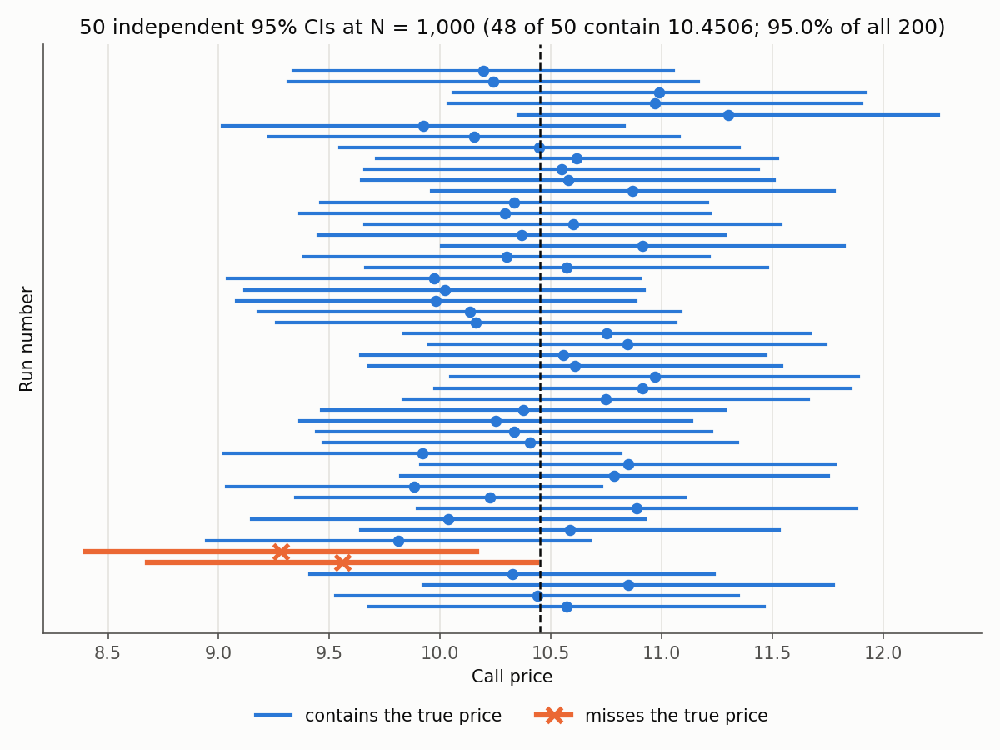
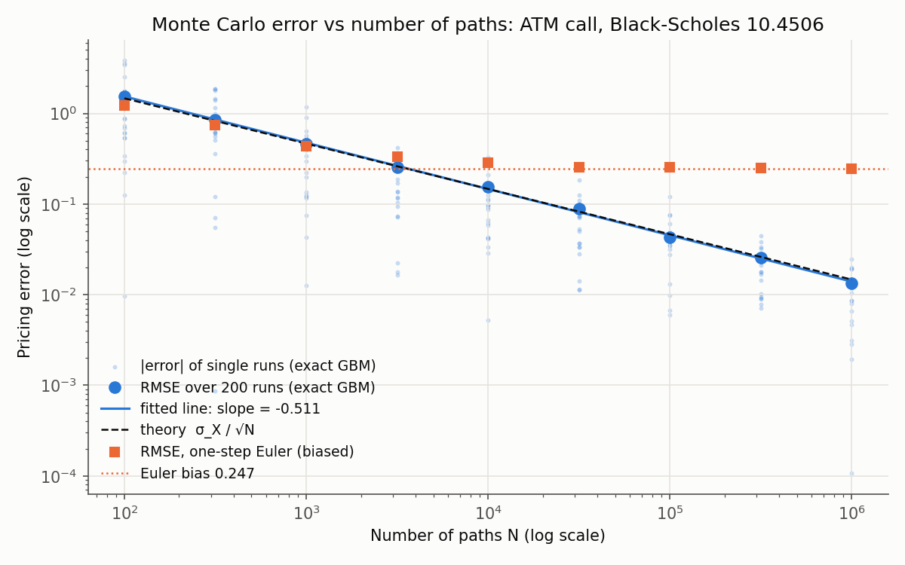
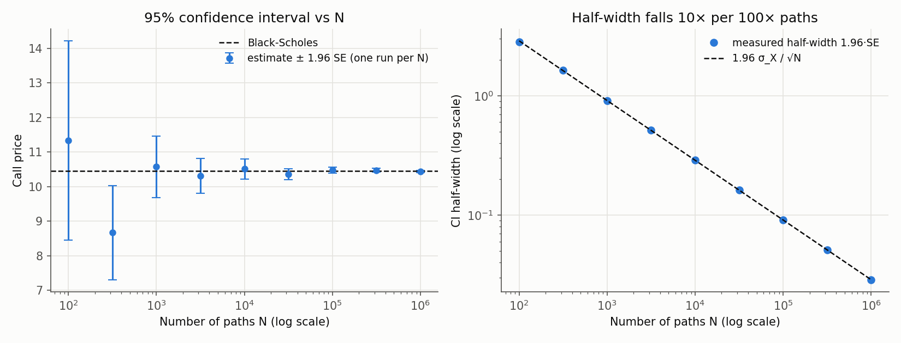

# Chapter 04: Convergence: Why Monte Carlo Error Shrinks Like 1/√N

Chapter 03 built a pricer that matches Black–Scholes. This chapter asks *how well* it
matches as we spend more paths, and what the numbers it reports alongside the price
(the standard error and the confidence interval) actually mean.

We'll prove that the error shrinks like $1/\sqrt N$, then **measure** it: price the same
call with $N$ from 100 to 1,000,000 paths, 200 independent times at each $N$, and fit
the slope on a log–log plot. Then we answer the practical question:

> **To get 10× more accuracy, how many more paths do I need, and why is that a problem?**

(Short answer: 100× more, and every extra digit costs another 100×. Full answer in §7.)

**Contents**

1. [What problem this solves](#1-what-problem-this-solves)
2. [Why the error shrinks like 1/√N](#2-why-the-error-shrinks-like-1n)
3. [The standard error](#3-the-standard-error)
4. [The confidence interval](#4-the-confidence-interval)
5. [The experiment](#5-the-experiment)
6. [Bias: the error that doesn't shrink](#6-bias-the-error-that-doesnt-shrink)
7. [10× more accuracy: how many paths, and why that's a problem](#7-10-more-accuracy-how-many-paths-and-why-thats-a-problem)
8. [Code walkthrough](#8-code-walkthrough)
9. [Common pitfalls](#9-common-pitfalls)
10. [Interview questions](#10-interview-questions)
11. [Exercises](#11-exercises)

---

## 1. What problem this solves

A Monte Carlo price is a random number. Run it again with a different seed and you
get a different answer. A number like "10.4634" is meaningless on its own; "10.4634 ±
0.0329" is a usable result.

In practice:

- **Trading desks** choose how many paths to run so that the pricing noise is smaller
  than the bid–ask spread. Noise bigger than the spread means you can't tell a good
  trade from a bad one.
- **Risk systems** reprice thousands of positions under hundreds of scenarios every
  night. The path count per pricing sets the compute bill.
- **Model validation teams** (and regulators) require convergence evidence: show that
  the estimate settles down at the rate theory predicts, and that the reported error
  bars are honest.

All three rely on the same small piece of theory.

---

## 2. Why the error shrinks like 1/√N

### 2.1 The setup

Each path $i$ gives one **discounted payoff** $X_i = e^{-rT}g(S^{(i)})$. The paths are
independent and identically distributed (i.i.d.), with

- true mean $\mathbb{E}[X_i] = V$, the price we want, and
- true standard deviation $\sigma_X = \sqrt{\operatorname{Var}(X_i)}$, the spread of a
  *single* discounted payoff. (We write $\sigma_X$, not $\sigma$, to avoid confusing it
  with the stock's volatility.)

The estimator is the sample mean $\hat V_N = \frac1N\sum_{i=1}^N X_i$.

### 2.2 The estimator is right on average

By linearity of expectation, $\mathbb{E}[\hat V_N] = \frac1N\sum\mathbb{E}[X_i] = V$.
The estimator is **unbiased**: it has no systematic error, only random error.

### 2.3 The random error is σ_X/√N

The variance of a sum of **independent** variables is the sum of their variances
(Chapter 01 §3.3), and scaling by $1/N$ scales variance by $1/N^2$:

$$
\operatorname{Var}(\hat V_N) = \frac{1}{N^2}\sum_{i=1}^N\operatorname{Var}(X_i) = \frac{1}{N^2}\cdot N\sigma_X^2 = \frac{\sigma_X^2}{N}
\quad\Longrightarrow\quad
\operatorname{sd}(\hat V_N) = \frac{\sigma_X}{\sqrt N}.
$$

Because the estimator is unbiased, its typical error, the **root-mean-square error**,
equals its standard deviation:

$$
\text{RMSE} = \sqrt{\mathbb{E}\big[(\hat V_N - V)^2\big]} = \frac{\sigma_X}{\sqrt N}.
$$

### 2.4 The intuition: errors partly cancel

Each $X_i$ misses $V$ by a random amount $X_i - V$, sometimes up, sometimes down. Add up
$N$ such misses and they **partly cancel**. The total behaves like a random walk, whose
typical size grows like $\sqrt N$, not $N$. (It's the same $\sqrt{\text{time}}$ rule as
Brownian motion in Chapter 01 §5.) Dividing the total by $N$ to get the average leaves
$\sqrt N/N = 1/\sqrt N$.

If the misses all pointed the same way (a bias), they wouldn't cancel, and averaging
wouldn't help. That's §6.

### 2.5 What this looks like on a log–log plot

Take logs of $\text{RMSE} = \sigma_X N^{-1/2}$:

$$
\log_{10}\text{RMSE} = \log_{10}\sigma_X - \tfrac12\log_{10}N.
$$

On log–log axes that's a **straight line with slope −½**. Its height is set by
$\sigma_X$. So a plot of log(error) against log(N) tests two things at once: the slope
tests the rate, and the intercept tests $\sigma_X$.

### 2.6 What the rate does *not* depend on

The derivation never used the number of random inputs per path, or how smooth the
payoff is. One normal draw per path (a European call) or 252 per path (a daily Asian
option): the rate is $1/\sqrt N$ either way. Grid-based integration is the opposite.
The trapezoid rule's error for a smooth function in $d$ dimensions with $N$ grid points
is roughly $N^{-2/d}$:

| Dimensions $d$ | Trapezoid rule error | Monte Carlo error |
|---:|---|---|
| 1 | $N^{-2}$ (far better) | $N^{-1/2}$ |
| 4 | $N^{-1/2}$ (same) | $N^{-1/2}$ |
| 252 | $N^{-0.008}$ (useless) | $N^{-1/2}$ |

That's why Monte Carlo dominates for path-dependent and multi-asset pricing, even
though $1/\sqrt N$ is slow.

---

## 3. The standard error

$\sigma_X$ is unknown; it's a property of the payoff's distribution, which is what
we're trying to learn. So we estimate it from the same samples, with the **sample
standard deviation** (dividing by $N - 1$; see Chapter 01 §4.3):

$$
s = \sqrt{\frac{1}{N-1}\sum_{i=1}^N (X_i - \hat V_N)^2},
\qquad
\boxed{\;\text{SE} = \frac{s}{\sqrt N}\;}
$$

**The standard error is our estimate, from a single run, of how far that run's price
is likely to be from the truth.** It's the thing `PricingResult.std_error` reports.

Keep three quantities apart:

| Symbol | Name | What it measures | Changes with $N$? |
|---|---|---|---|
| $\sigma_X$ (estimated by $s$) | std dev of one payoff | how spread out individual path payoffs are | **no**: it's a property of the payoff |
| SE $= s/\sqrt N$ | standard error | how uncertain the *average* is | yes, falls like $1/\sqrt N$ |
| RMSE | actual typical error | what SE is trying to estimate | yes, falls like $1/\sqrt N$ |

For the at-the-money call ($S_0 = K = 100$, $T = 1$, $r = 5\%$, $\sigma = 20\%$), the
experiment measures $\sigma_X = 14.69$. A single path's discounted payoff is typically
about 15 away from the price of 10.45. Most paths pay 0, and a few pay 30 or more.
Averaging is what turns this noisy quantity into a precise price.

**Does SE actually track the real error?** Yes, as long as there's no bias. Compare the
"mean SE" and "RMSE" columns of the table in §5.2: they agree to within the noise at
every $N$ (for example 0.0466 vs 0.0434 at $N = 10^5$).

---

## 4. The confidence interval

### 4.1 Construction

The CLT (Chapter 01 §4.2) says that for large $N$,
$\hat V_N \approx N\big(V, \text{SE}^2\big)$. A normal variable lies within 1.96 standard
deviations of its mean with probability 95%, so

$$
P\big(|\hat V_N - V| < 1.96\,\text{SE}\big) \approx 0.95
\quad\Longleftrightarrow\quad
P\big(V \in [\hat V_N - 1.96\,\text{SE},\ \hat V_N + 1.96\,\text{SE}]\big) \approx 0.95.
$$

That interval is the **95% confidence interval**: `PricingResult.ci_95`.

| Level | Multiplier $z$ | Interval misses about… |
|---:|---:|---|
| 68% | 1.000 | 1 in 3 |
| 90% | 1.645 | 1 in 10 |
| 95% | 1.960 | 1 in 20 |
| 99% | 2.576 | 1 in 100 |
| 99.73% | 3.000 | 1 in 370: our test threshold |

Our tests use 3 SE rather than 1.96 because they run hundreds of checks. At 1.96, about
one check in 20 would fail by pure chance.

### 4.2 What "95% confident" means, and what it doesn't

**It means:** the *procedure* "take $\hat V \pm 1.96\,\text{SE}$" produces intervals that
contain the true price in 95% of runs. If you ran the pricer 100 times with different
seeds, about 95 of the 100 intervals would cover 10.4506 and about 5 would miss.

*50 independent runs at $N = 1{,}000$. Each horizontal line is one run's 95% CI and the
dashed line is the true price. 48 of these 50 cover it, and 95.0% of all 200 runs do.
The two misses (orange ×) aren't bugs. They're the 5% the procedure promises. Notice
the second miss falls short by a hair.*

**It does not mean** "there's a 95% probability that the true price lies in *this*
interval." The true price is a fixed number; it's either in a given interval or not.
The 95% describes how reliable the *method* is, not any single interval.

### 4.3 When a confidence interval lies

The derivation assumed the samples are independent, the estimator is unbiased, and $N$
is large enough for the CLT. Break any of these and the stated 95% isn't 95%:

1. **Small $N$ with a skewed payoff.** Call payoffs are very skewed: most are 0, a few
   are huge. With $N = 100$ the sample mean isn't yet normal, and $s$ tends to
   underestimate $\sigma_X$ because rare big payoffs are often missing from the sample.
   Coverage in our experiment was 92.0% at $N = 100$, and the mean SE (1.44) was below
   the real RMSE (1.53).
2. **Bias.** The interval is centred on the estimate. If the estimate is systematically
   wrong, a narrower interval just becomes *more confidently wrong* (§6).
3. **Correlated samples.** Reusing random numbers across runs (Chapter 03 §7), or
   low-discrepancy sequences (Chapter 06), break the independence that $\sigma_X^2/N$
   relies on.
4. **Infinite variance.** If $\sigma_X = \infty$ (some heavy-tailed payoffs), the CLT fails
   and SE is meaningless (Exercise 2).

---

## 5. The experiment

### 5.1 Design

- At-the-money call, $S_0 = K = 100$, $T = 1$, $r = 5\%$, $\sigma = 20\%$, so the true
  price is 10.4506.
- $N \in \{100, 316, 1000, \dots, 10^6\}$: 9 values, evenly spaced in $\log N$ (half a
  decade apart).
- **200 independent runs at each $N$**, each with its own seed, so no two runs share
  random numbers.
- For each $N$: the RMSE over the 200 runs, the average reported SE, and the fraction of
  runs whose 95% CI covers the truth.
- Fit a straight line to $\log_{10}\text{RMSE}$ vs $\log_{10}N$.

**Why 200 runs instead of one?** The error of a single run is itself random: it could
land almost on the truth by luck, or 2 SE away. Fitting a slope through 9 single
errors gives a noisy slope. Averaging squared errors over 200 runs pins the RMSE down
to about ±5%, so the fitted slope is reliable.

### 5.2 Results

*Faint dots: the error of individual runs (20 per N shown); notice the spread of more
than a factor of 10 at every $N$. Blue circles: RMSE over 200 runs. Blue line: fitted
slope **−0.511**. Dashed: the theory line $\sigma_X/\sqrt N$, almost indistinguishable
from the fit. Orange squares: a deliberately biased pricer (§6). It follows the same
line at first, then flattens at its bias.*

| N | mean SE | RMSE | RMSE·√N | 95% CI coverage | Euler RMSE | runtime (s) |
|---:|---:|---:|---:|---:|---:|---:|
| 100 | 1.4395 | 1.5291 | 15.29 | 92.0% | 1.2300 | 0.0000 |
| 316 | 0.8324 | 0.8579 | 15.25 | 94.5% | 0.7469 | 0.0001 |
| 1,000 | 0.4650 | 0.4593 | 14.52 | 95.0% | 0.4375 | 0.0001 |
| 3,162 | 0.2617 | 0.2539 | 14.28 | 97.5% | 0.3303 | 0.0001 |
| 10,000 | 0.1471 | 0.1556 | 15.56 | 93.0% | 0.2855 | 0.0002 |
| 31,623 | 0.0828 | 0.0889 | 15.81 | 93.0% | 0.2525 | 0.0006 |
| 100,000 | 0.0466 | 0.0434 | 13.72 | 97.0% | 0.2539 | 0.0029 |
| 316,228 | 0.0262 | 0.0256 | 14.42 | 95.5% | 0.2492 | 0.0124 |
| 1,000,000 | 0.0147 | 0.0133 | 13.31 | 97.0% | 0.2476 | 0.0374 |

How to read it:

- **Fitted slope: −0.511** (theory −0.5). The small difference is noise: each RMSE is
  estimated from 200 runs and is uncertain by about ±5%.
- **RMSE·√N is roughly constant, around 14–16**, matching $\sigma_X = 14.69$. That's
  the $1/\sqrt N$ law in a single column: if the error shrank at any other rate, this
  column would drift up or down.
- **Every 100× increase in N cuts the error by 10×**: 1.53 → 0.155 → 0.0133.
- **Coverage hovers around 95%** (92–97.5%). With 200 runs per row, the coverage
  estimate itself has a standard error of about 1.5%, so 92% and 97.5% are both
  plausible for a true 95%. The 92% at $N = 100$ is also the small-sample effect
  described in §4.3.
- **A single run per N would also give about −0.5 here (−0.495)**, but that's partly
  luck: the faint dots show any one run could be 10× off the line.

*Left: one run per N, with its 95% CI. The interval collapses onto the true price: ±2.9
at $N = 100$, ±0.029 at $N = 10^6$. Right: the half-width on log–log axes falls exactly
along $1.96\,\sigma_X/\sqrt N$. Every 100× more paths gives a 10× narrower interval.*

---

## 6. Bias: the error that doesn't shrink

Real pricers can have **systematic** error too: a discretisation scheme that's slightly
wrong (Euler, Chapter 03 §4.2), a truncated model, or a wrong parameter. The full error
splits into two parts:

$$
\text{MSE} = \mathbb{E}\big[(\hat V_N - V)^2\big] = \underbrace{\big(\mathbb{E}[\hat V_N] - V\big)^2}_{\text{bias}^2} + \underbrace{\frac{\sigma_X^2}{N}}_{\text{variance}}.
$$

More paths shrink only the variance term. The orange squares in the log–log plot are
the one-step Euler pricer from Chapter 03, with bias −0.247:

- For small $N$ the noise dominates, and Euler looks just as good as the exact scheme.
- Around $N \approx 3{,}000$ the noise falls below the bias, and the curve **flattens**.
  From then on, extra paths buy nothing.
- At $N = 10^6$, Euler's CI is about $10.204 \pm 0.029$. It **excludes the true price by
  a wide margin while looking very precise**.

Lessons:

1. **A confidence interval only measures noise. It can't detect bias.** The only
   protection is testing against a known answer, which is why Chapter 02's benchmark
   exists.
2. **A convergence plot is a bias detector.** If log(error) flattens instead of
   continuing at slope −½, something systematic is wrong.
3. When a method has both kinds of error (e.g. Euler with $m$ time steps: bias $\propto 1/m$,
   variance $\propto 1/N$, cost $\propto N\cdot m$), it's wasteful to drive either one far
   below the other. Balancing them gives RMSE $\propto \text{cost}^{-1/3}$, worse than
   the $\text{cost}^{-1/2}$ of an exact scheme. Exercise 3 works this out.

---

## 7. 10× more accuracy: how many paths, and why that's a problem

### 7.1 The answer: 100× more paths

Accuracy means a smaller standard error. From $\text{SE} = \sigma_X/\sqrt N$, the number
of paths needed for a target SE is

$$
N = \left(\frac{\sigma_X}{\text{SE}}\right)^2.
$$

Cutting SE by a factor of 10 multiplies $N$ by $10^2 = 100$. In general, **cutting the
error by a factor $k$ costs $k^2$ times the paths.**

For our call ($\sigma_X = 14.69$), timed with the engine on this laptop:

| Target SE | Paths needed $(\sigma_X/\text{SE})^2$ | Time at measured speed |
|---:|---:|---:|
| 0.1 | 21,582 | 0.001 s |
| 0.01 | 2,158,196 | 0.08 s |
| 0.001 | 215,819,640 | 8 s |
| 0.0001 | 21,581,964,005 | 13.5 min |

### 7.2 Why that's a problem

**1. Each extra digit costs 100×.** Computing cost grows linearly with $N$, so
$\text{cost} \propto 1/\text{error}^2$. Going from 2 to 4 correct decimal places takes
the time from 0.08 s to 13.5 minutes. The last row also needs 21.6 billion random
numbers: about 173 GB if held in memory at once, so it has to be computed in batches.

**2. Real workloads multiply it.** A desk doesn't price one option once. Take 5,000
options, each needing a price plus 5 Greeks by bump-and-revalue (11 repricings with
central differences), at SE 0.001: $5{,}000 \times 11 \times 8\text{ s} \approx 123$
**hours**, every night. Path-dependent products multiply this again by the number of
time steps. Risk scenarios (Chapter 14) multiply it once more.

**3. Other methods improve much faster.** For a smooth one-dimensional integral, the
trapezoid rule's error falls like $N^{-2}$: 10× accuracy costs only $\sqrt{10} \approx 3.2$×
more points, not 100×. Monte Carlo wins only because its rate doesn't get worse in high
dimensions (§2.6). It's *reliably* slow, not fast.

**4. You can't buy your way past bias.** If the method is biased (§6), even infinite
paths don't help.

### 7.3 What to do about it

$\text{SE} = \sigma_X/\sqrt N$ has exactly two handles besides $N$:

| Attack | Idea | Effect | Chapter |
|---|---|---|---|
| Shrink $\sigma_X$ | **Variance reduction**: antithetic variates, control variates, importance sampling | Halving $\sigma_X$ is worth 4× the paths; a good control variate can be worth 100× | 05 |
| Improve the exponent | **Quasi-Monte Carlo**: evenly spread points instead of random ones | Error close to $1/N$ instead of $1/\sqrt N$ for well-behaved problems | 06 |
| Make each path cheaper | Vectorisation, Numba, batching | Same $N$, less time | 13 |

---

## 8. Code walkthrough

### `docs/figures/make_ch04.py`

This chapter adds no library code. The experiment is a script that uses the engine
unchanged: `GBM`, `European` and `price()` from Chapter 03.

- `NS = np.logspace(2, 6, 9)`: the 9 path counts, 100 to 10⁶.
- `seed_for(k, run)` returns `10_000 * k + run`, a different seed for every
  (N, run) pair. Using `seed=run` for all N instead would make the run at $N = 1000$
  start with the same draws as the run at $N = 100$, so the rows would be correlated.
- The main loop calls `price(MODEL, CALL, T, n, seed=...)` 200 times per N and stores
  the price, SE and runtime.
- `rmse = np.sqrt((err**2).mean(axis=1))` averages over runs (axis 1) for each N.
- `np.polyfit(np.log10(NS), np.log10(rmse), 1)` fits the straight line; its first
  coefficient is the slope.
- `euler_one_step` is a biased pricer, built inline on purpose, to show bias in the
  plot. It isn't in the library.
- `sys.stdout.reconfigure(encoding="utf-8")` lets the tables print `√` and `σ` on
  Windows consoles.

Run it from the repo root: `python -m docs.figures.make_ch04` (takes about 30 s).

### New test: `test_confidence_interval_covers_about_95_percent` (`tests/test_engine.py`)

It prices the call 200 times at $N = 10{,}000$ with seeds 0–199 and checks that the
fraction of CIs containing the true price is between 90.4% and 99.6%. Why that band:
the number of hits is Binomial(200, 0.95), with standard deviation
$\sqrt{0.95 \times 0.05/200} = 1.5\%$, and the band is ±3 of those. The seeds used
give 91.5%. This test checks that the **SE is honest**, not just that the price is
close. A bug that inflated or deflated `std_error` would pass every "within 3 SE" test
but fail this one.

---

## 9. Common pitfalls

1. **Reporting a Monte Carlo price without its SE.** Without an error bar the number
   can't be interpreted.
2. **Confusing $\sigma_X$ with SE.** $\sigma_X$ is the spread of one payoff and doesn't
   shrink. SE is the spread of the average and does.
3. **Fitting a convergence slope from single runs.** Any one run can be 10× off the line
   by luck. Average squared errors over independent repetitions.
4. **Reusing seeds across the runs you're comparing.** Correlated runs make coverage
   statistics and slopes misleading (Chapter 03 §7).
5. **Reading a CI as "95% probability the price is in here".** The 95% belongs to the
   procedure, not to one interval.
6. **Trusting a narrow CI from a biased method.** The CI measures noise only. Test
   against a benchmark, and look for flattening on the log–log plot.
7. **Running "until the CI looks good".** Stopping when the estimate happens to be
   near the value you expected biases the result. Fix $N$ in advance, or use a rule
   based on the SE alone.
8. **Trusting SE with very small N on skewed payoffs.** It tends to be too small; use
   at least a few thousand paths before trusting the CI.

---

## 10. Interview questions

**1. You want 10× more accuracy from a Monte Carlo pricer. How many more paths?**
100×. SE $= \sigma_X/\sqrt N$, so $N \propto 1/\text{SE}^2$: each extra decimal digit
costs 100× the compute. That's why practitioners reduce $\sigma_X$ (variance reduction)
or improve the rate (quasi-Monte Carlo) instead of just adding paths.

**2. Why does the error go like $1/\sqrt N$, and why doesn't it depend on the dimension?**
The estimator is an average of $N$ i.i.d. samples. Its variance is $\sigma_X^2/N$ because
the variances of independent terms add. The derivation only uses $\sigma_X$, never the
number of random inputs per path, so the rate is the same in 1 or 1,000 dimensions.
Grid methods, by contrast, degrade like $N^{-c/d}$.

**3. What does a 95% confidence interval from a Monte Carlo pricer mean?**
That the procedure (estimate ± 1.96 SE) contains the true price in about 95% of
independent runs. It doesn't mean a 95% probability that the true price is in this
particular interval. It relies on independence, no bias, and $N$ large enough for the CLT.

**4. Your pricer's error stops decreasing after some N. What's happening, and what do you do?**
There's bias: discretisation error, a model approximation, or a bug. More paths only
shrink the variance part of $\text{MSE} = \text{bias}^2 + \sigma_X^2/N$. Diagnose by testing
against a known price and by varying the time step. If the method has a step size,
balance bias and variance rather than pushing $N$ alone.

**5. How would you empirically verify a pricer's convergence rate?**
Run $M$ independent replications (distinct seeds) at each of several $N$ spaced
geometrically, and compute the RMSE against a known price at each $N$. Regress
$\log\text{RMSE}$ on $\log N$; expect slope −½. Also check that RMSE·√N is roughly
constant, and that 95% CIs cover about 95% of the time.

---

## 11. Exercises

**Exercise 1: out-of-the-money options are harder.** Repeat the study for $K = 140$
(price 0.785).
(a) Estimate $\sigma_X$. Is the slope still −½?
(b) The *relative* error is SE/price. How many paths does each strike need for a 1%
relative SE?
(c) Explain why deep out-of-the-money options are expensive to price by Monte Carlo.
(Chapter 05's importance sampling is the fix.)

Check your answers

$\sigma_X \approx 4.25$ for $K = 140$ vs 14.71 for $K = 100$. The slope is still −½. But
$\sigma_X/\text{price}$ is 5.4 vs 1.4, so 1% relative SE needs about 293,000 paths vs
20,000, about 15× more. Most paths pay zero, so the price rests on the few that don't.

**Exercise 2: when $1/\sqrt N$ fails.** Draw samples from a Pareto distribution with
$\alpha = 1.5$ (`rng.pareto(1.5, N) + 1`). Its mean is $\alpha/(\alpha - 1) = 3$, but
its variance is **infinite**.
(a) Run the same RMSE-vs-N study (estimating the mean, true value 3). What slope do you get?
(b) What coverage do the "95%" intervals achieve?
(c) Which assumption in §2.3 broke?

Hint

Expect a slope noticeably flatter than −½ (theory: $1/\alpha - 1 = -1/3$) and coverage
well below 95%. With infinite variance the CLT doesn't apply, so neither does the SE.
Payoffs proportional to $e^{cZ^2}$ or to powers of $S_T$ can behave this way.

**Exercise 3: steps vs paths with a biased scheme.** Suppose the Euler scheme with $m$
steps has bias $\approx c/m$, and each path costs $m$ units of work. You have a total
budget $B = N\cdot m$.
(a) Write the MSE as a function of $m$ only (eliminate $N$).
(b) Minimise it: show the best $m$ grows like $B^{1/3}$ and the RMSE falls like $B^{-1/3}$.
(c) Compare with the exact GBM scheme, where $m = 1$ suffices: RMSE $\propto B^{-1/2}$. For
$B = 10^8$, roughly how much more accurate is the exact scheme?

Hint

$\text{MSE}(m) = c^2/m^2 + \sigma_X^2 m/B$. Setting the derivative to zero gives
$m^3 = 2c^2B/\sigma_X^2$. The ratio of the two RMSEs grows like $B^{1/6}$: about 20×
at $B = 10^8$, up to constants.

